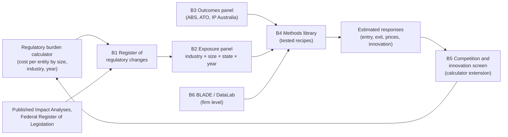

# Scoping: an econometric foundation for regulation, competition and innovation

**Status:** Scoping note, 14 October 2026. **Decisions taken the same day** (`alcia/DECISIONS.md`, E-01 to E-07):
- evaluate past regulation first;
- public data only, no BLADE;
- Commonwealth and state changes;
- explore the menu of assessable legislation before choosing pilots;
- Python;
- calculator paused;
- all public.

Work under way: `alcia/` (register, date gatherer, menu explorer) and `docs/impact_evaluation_design.md`.

**Request (project owner, 14 Oct 2026):**
- Defer Phase 2b, the AI drafting assistant.
- First, scope a strong econometric foundation for analysing the impact of regulation. That means effects on existing businesses (what the calculator measures), and also on **competition** and **innovation** in the sectors affected.

**Supersedes** stage S3 of `regulatory-burden-tool/docs/scope_expansion.md`, which assumed a smaller "competition module" fed by outside estimates.

Sources were checked on 14 October 2026; the list is in section 12. Anything the research could not confirm is marked **(unverified)**.

---

## 1. Short answer

**It's feasible.** The repository's purpose already points this way: "assess where business dynamism is constrained and what policy drivers can be used to lift productivity through higher competition". But this is a **research programme, not a feature**. The binding constraints are identification and data access, not code.

**There is a real gap to fill:**

- **The aggregate story is already told.** Treasury, the RBA and e61 have documented:
  - rising concentration (top-four share in the average industry, 41% in 2001–02 to 43% in 2018–19);
  - markups up about 5% since the mid-2000s;
  - slower reallocation;
  - a productivity cost of 1–3%.
- **The impact of specific regulations isn't.** Nobody has **regulation-specific, causal estimates**, or a way to turn a compliance-cost estimate into a predicted effect on entry, exit or innovation:
  - OIA's burden framework **excludes** "indirect costs, including changes to market structure and competition impacts" (RBM p. 4).
  - OIA's new competition guidance (July 2026) says these costs "may need to be described in qualitative terms".
  - Internationally, the research found no government that converts compliance-cost estimates into quantitative entry or innovation predictions. Practice stops at checklists, cost-to-sales screens and price rules of thumb.
  - The academic evidence measures regulation by **counts of rules** or registration costs, not **dollars of compliance cost per firm**. Estimating responses to dollar costs would be new.

**What makes this project distinctive:** the calculator already produces exactly the missing input. It gives compliance cost per entity, by size cohort, industry (ANZSIC) and year, for any regulatory change. Recorded systematically across many changes, that becomes the "treatment" variable every econometric design needs.

**Recommendation:**

1. **Build a public register of regulatory changes** with costs attached. Link it to public outcome data (entry, exit, survival, industry performance, prices, innovation) on shared keys: industry × size band × state × year.
2. **Build a tested methods library**, then prove the whole pipeline on **three pilot studies** (section 7) before scaling up.
3. **Run a firm-level track on BLADE in parallel**, if you have an organisational sponsor. Markups, concentration, bunching at thresholds and most innovation outcomes are only possible there.
4. **Close the loop.** Feed the resulting estimates back into the calculator as a separate "competition and innovation screen". It follows OIA's competition tests and never touches the burden estimate (RBE).

**Timing:** the Productivity Commission's inquiry *Reducing barriers to business dynamism* (interim report November 2026, final May 2027) is the natural audience for the first results.

---

## 2. What you asked for, made concrete

| Layer | Question | Today |
|---|---|---|
| 1. Existing businesses | What does a regulation cost the firms already in the market? | **The calculator (RBM).** Done for Phases 1–2 |
| 2. Competition and business dynamism | Does it change entry, exit, survival, growth, concentration, markups or prices? Does it fall harder on small or new firms? | Not measured. OIA asks for it qualitatively |
| 3. Innovation | Does it change R&D, patenting, new products or business models, or the speed of adoption? | Not measured |

Each layer can be studied in two directions:

- **Ex post: what did past regulation do?** This needs a record of what changed and when, outcome data, and a credible comparison group.
- **Ex ante: what will this proposal do?** This needs **response parameters**, such as how much entry falls when the fixed cost of compliance rises by $X for a small firm. Those parameters come from ex post work or from cited studies.

**Recommendation:** ex post first. It produces the parameters ex ante analysis needs, and an ex ante tool without them would be guessing.

---

## 3. How regulation reaches competition and innovation

| # | Channel | Mechanism | What the calculator gives today |
|---|---|---|---|
| C1 | **Compliance costs** | A fixed or one-off cost weighs more on small firms and entrants. Fewer entrants, more exits of small firms, higher concentration; possibly higher markups and prices | Per-entity cost by size cohort, industry and year (tidy export) |
| C2 | **Entry barriers** | Licences, approvals, waiting times, limits on the number of suppliers | Delay costs for approvals (RBM pp. 2, 10); nothing for limits on numbers |
| C3 | **Size thresholds** | Obligations that start at a size threshold create a cost "cliff". Firms stay just below it, grow more slowly and may innovate less | Cliff flags on per-entity results |
| C4 | **Rules on how firms compete** | Rules on price, advertising, products or trading hours; standards; information requirements | Nothing (not a compliance cost) |
| C5 | **Innovation** | Compliance diverts resources from R&D; approval requirements delay launches; uncertainty. Standards and sandboxes can also *enable* innovation | Nothing |

C1–C4 match OIA's competition guidance, Step 1 (July 2026), which is "broadly based on" the OECD *Competition Assessment Toolkit*. Its categories are:
- barriers to entry, growth or exit;
- the number or types of businesses that can operate;
- the ability or incentives to compete;
- conditions that influence prices or market share;
- consumer choices and information.

**One assumption must be tested, not taken as given.** The usual view is that compliance costs are mostly fixed and so hit small firms hardest. Finnish evidence supports it: firms bunch below the VAT threshold to avoid compliance costs (Harju, Matikka & Rauhanen 2019). But US data show compliance spending as a share of the wage bill **peaks at mid-sized firms** (about 500 employees), not the smallest (Trebbi, Zhang & Simkovic 2026). Small firms may outsource, be exempt, or not comply. The foundation should measure where the burden falls rather than build in an answer.

---

## 4. The foundation: six building blocks

### B1. A register of regulatory changes (the "treatment" data)

No public Australian dataset records what changed, when and for whom, at industry × size × time level, with a cost attached. The register would hold **one record per regulatory change**:

| Field group | Content |
|---|---|
| What | Instrument and provision (matching the calculator's `legalReference`); description; channel (C1–C5); OECD/OIA category |
| When | Announced, legislated, commenced; phase-in dates by group (e.g. climate reporting Groups 1–3) |
| Who | Jurisdiction; affected industries (ANZSIC codes, each with an exposure weight); size thresholds and how size is measured; entity types |
| How much | Per-entity compliance cost by size cohort, either from a calculator costing or from a published Impact Analysis, with the source. Blank if unknown, never invented |
| Provenance | Source documents; coder; confidence; second coder for a sample (inter-coder agreement reported) |

**Sources for building it:**
- **OIA's published Impact Analyses.** About 1,540 entries. Each has a free-text "regulatory burden" field and attached IAs, but there is no CSV export and **no industry split**, so industry exposure must be coded by hand.
- **The Federal Register of Legislation.** Has a free REST API with making dates, in-force status, version start and end dates, and full text.

**Rules:**
- The register only holds **public** information: enacted law and published IAs. Confidential proposals never enter it, so the privacy rules for Cabinet-in-confidence material don't arise.
- Each IA burden figure is the agency's own ex ante estimate. It is recorded as that, with its stated range where there is one. The 2025–26 EPBC reforms, for example, have an OIA-certified range of $0.45–6.9bn.

### B2. Exposure panel

The register aggregated to **industry × size band × state × year**. Measures:

- cumulative compliance cost per entity, and the **"dose"**: that cost as a share of typical revenue or wage bill in the cell;
- counts of changes, by channel;
- threshold indicators (cells just below and just above a size threshold);
- upstream exposure: costs on suppliers, weighted by ABS input–output links;
- optionally, a text-based measure of the stock of regulation. *RegData Australia* (Mercatus/QuantGov) covers Commonwealth instruments; whether it is still maintained, and which industry classification it uses, are **(unverified)**.

### B3. Outcomes panel (public data)

| Outcome | Best public source | Finest detail | Caveats |
|---|---|---|---|
| Entry, exit, net entry | ABS *Counts of Australian Businesses* (CABEE) | State × ANZSIC **class** × employment or turnover band | Each release covers only its latest 2 years, so a panel means stitching releases. Series breaks in 2010, 2013, 2016, 2017, 2020–21 and 2021–22. Excludes businesses not registered for GST. To be replaced over several years by a "Business Characteristics Asset" |
| Long consistent business series | ABS *Businesses in Australia* TableBuilder (built from BLADE) | Class × state × business age; headcount, sales, wages and capex as numeric items; FY2002–2024 | Free for registered users. Aggregate tables only; at most 3 categorical items per table. Publication terms still to be checked |
| Survival | CABEE survival cubes | State × **subdivision** × size, over 4 years | As for CABEE |
| Industry performance | ABS *Australian Industry*; ATO *Taxation Statistics* | Subdivision (ABS), from 2006–07; ATO company tables by ANZSIC group or class, by size, from 2009–10 | Australian Industry gives class detail for manufacturing only |
| Prices (pass-through) | ABS CPI (87 expenditure classes, monthly); producer price indexes | PPIs to class level for manufacturing and construction | Concording expenditure classes to industries is approximate |
| Innovation | ABS *Characteristics of Australian Business* (innovation-active share); BERD; IP RAPID (patents, trade marks, designs); ATO R&D Tax Incentive transparency report | Division × size (CAB); subdivision × size (BERD); firm-level for IP and R&DTI | CAB and BERD are biennial, and CAB has a 2024–25 break. IP RAPID has an ABN for some parties but **no industry code**. The R&DTI report covers 2021–22 onward, also with no industry code |
| Concentration | RBA RDP 2025-05 supplementary data | Division-level summaries, FY2002–2019 | No public industry-by-industry series. Treasury's are not published |

### B4. Methods library

Estimators packaged as **tested recipes**. Each recipe:

- states its assumptions;
- runs standard diagnostics (pre-trends, placebo tests, sensitivity bounds);
- writes a standard output table.

**Every recipe is tested on simulated data with a known true effect**, clearly labelled as simulated. That's how we know the code recovers the right answer, without inventing real-world data. Section 6 lists the recipes.

### B5. The competition and innovation screen (back into the calculator)

A calculator **extension**, using the existing read-only extension interface. It is reported separately from the RBE, which stays pure (RBM p. 4). It follows OIA's three competition tests:

- **Step 1 (does it affect competition?):**
  - the OIA/OECD checklist;
  - compliance cost as a share of revenue by size cohort;
  - the **small-to-large cost ratio** (how regressive the burden is);
  - cliff flags at thresholds;
  - a note that significance is judged "by reference to a specific market", as OIA asks.
- **Step 2 (less restrictive alternatives):** compare the options already in the proposal on the same measures.
- **Step 3 (net benefit):** once estimates exist, **indicative ranges** for changes in entry and exit rates. Each range comes from the register-based estimates or a cited study, with the source shown. Nothing is shown where no evidence exists.

This is consistent with DECISIONS #44. The calculator still does no econometrics; it only applies published estimates.

### B6. Firm-level tier (BLADE in ABS DataLab)

The only route to:
- firm-level entry, exit and growth;
- bunching at size thresholds;
- concentration at class level after 2019;
- markups;
- linked innovation data (patents, R&DTI, business surveys).

**What BLADE now contains:** BAS from 2001–02, business income tax, PAYG, Single Touch Payroll, IP data, ASIC insolvency data, business locations, and ABS surveys. Linked employer–employee data are available through PLIDA.

**Access:**
- An organisation signs a Responsible Officer Undertaking.
- Researchers complete Safe Researcher Training.
- The project needs Five Safes approval and data custodian approval.
- Charges are about **$6,050 a year for 1–5 analysts** (university researchers are not invoiced individually).
- Output clearance aims to take about **2 weeks**. New data integration takes 2–6 months. Project approval time isn't published.
- Outputs must pass ABS confidentiality rules: at least 10 contributors per cell, dominance rules, residual degrees of freedom.

**In this repository:** code lives here, written to run inside DataLab (R, Python and Stata are available). **Data never does.** Results leave DataLab only after ABS clearance.

---

## 5. What already exists (build on it, don't repeat it)

| Body | Relevant work | Use for this project |
|---|---|---|
| Treasury: Competition Review (2023, ongoing) and its Competition Evaluation and Analysis Unit | BLADE and PLIDA analysis: concentration, markups (Hambur 2023), the cost of lost competition (Hambur & Freestone 2025, 1–3%), an administrative mergers database, non-compete clauses (2026), and an inverted-U link between competition and innovation (2026) | Benchmarks to replicate; methods; possible collaborators |
| RBA | Labour-market concentration (RDP 2023-02); occupational licensing stringency index for NSW, Vic and Qld: stricter licensing goes with lower entry and exit (RDP 2024-06) | The licensing index is ready-made exposure data for the occupational licensing pilot |
| e61 Institute | Bunching at South Australia's 2019 payroll-tax threshold change; non-compete clauses and wages; young-firm growth | The payroll-tax bunching result is a **replication target** to validate the bunching recipe |
| Productivity Commission | National Competition Policy modelling (CGE: GDP +1.0–1.7%, an "outer envelope"); *Creating a more dynamic and resilient economy* (Dec 2025), which recommended a $10bn cut in compliance and delay costs by 2030, an annual Regulation Review with broader indicators, and post-implementation reviews where effects are uncertain; the new **business dynamism inquiry** (terms of reference 12 May 2026; interim Nov 2026, final May 2027; excludes tax, workplace relations and mergers) | Audience and timing. Its "broader indicators" are what this project would produce |
| OIA | RBM framework (July 2026); competition guidance (July 2026); annual Impact Statement (2025–26: 19 IAs, net burden +$475.5m a year) | Specification for B5; source for B1 |
| Government | 2026–27 Budget claims $10.2bn a year of regulatory cost reductions (gross) | An ex post question this foundation could eventually answer: did claimed reductions change entry or competition in the industries concerned? |

**Positioning:** regulation-specific, open and reproducible. Public code, a documented register and simulation-tested methods. The aggregate measures are left to Treasury and the RBA.

---

## 6. Methods: what to build first

| Recipe | Fits | Data tier | Key pitfalls |
|---|---|---|---|
| **R1. Staggered event study**, robust to effects that differ across groups (Callaway & Sant'Anna; Borusyak, Jaravel & Spiess), with HonestDiD sensitivity bounds | Changes that hit industry × size × state cells at different dates | Public | Overlapping changes; anticipation; ordinary two-way fixed-effects regressions give misleading weights |
| **R2. Continuous-dose DiD** (Callaway, Goodman-Bacon & Sant'Anna) | Using the calculator's cost-to-revenue "dose" | Public | Comparing effects across dose levels needs stronger assumptions |
| **R3. Triple difference** (industry × size × time) | Does a cost fall harder on small firms? | Public, then BLADE | Size must be fixed in a base year; shortcut implementations break down when covariates are added |
| **R4. Bunching at size thresholds** (Kleven & Waseem) | Obligations that start at a headcount or turnover threshold. Backs out the cost firms **behave as if** they face, which tests the calculator's estimates against revealed behaviour | BLADE | Bunching at round numbers; distinguishing real responses from reporting; overlapping thresholds |
| **R5. Synthetic control / synthetic DiD** | A large reform in one state or industry | Public | Few comparison units; inference relies on placebo tests |
| **R6. Dynamism and innovation measures** | Entry, exit, survival, young-firm share, job reallocation; patents and trade marks (trade marks matter more in services); R&D; innovation-active share | Public, then BLADE | Concentration labelled **descriptive only**: national industry concentration isn't market power |
| **R7. Markups** (Hambur's De Loecker–Warzynski approach) | Changes over time, and small-vs-large gaps, not levels (Bond et al. 2021 critique) | BLADE | Revenue data can't pin down markup levels |
| **R8. Ex ante translator** (calibrated Hopenhayn-type firm-dynamics model; Bresnahan–Reiss entry thresholds for local services) | Turning a fixed compliance cost into predicted entry, exit and size distribution | Public, then BLADE | Results depend on how responsive entry is; validate against R1–R4 before use |

**Priors for R8, until our own estimates exist** (all measured against counts of rules or registration costs, not dollars):

| Prior | Source |
|---|---|
| Firm births −0.05% per 1% more regulatory restrictions | Bailey & Thomas 2017 |
| Number of firms −0.05% per 1% more restrictions | Chambers et al. 2022 |
| France's 50-employee rules are equivalent to about one year's average wage as a one-off cost | Gourio & Roys 2014 |
| The same rules cut aggregate innovation by 5.7% | Aghion, Bergeaud & Van Reenen 2023 |
| Removing an entry-cost restriction lowers prices by about 19% (UK CMA rule of thumb) | CMA 2023 guidelines, ch. 9 |

**Software:**
- **Python as the main language:** pyfixest, rdrobust, pysyncon, plus a DiD package.
- **R reference packages for cross-checks before any result is released:** did, contdid, triplediff, HonestDiD, fixest, bunching, prodest.
- **Gaps:** there's no maintained Python package for bunching or for production-function markups. We would write the first (it's small) and use R's prodest for the second. The newer all-in-one Python DiD package (diff-diff) is very new, so every result is checked against R.

---

## 7. Pilot studies (proposed)

Three pilots, chosen to exercise each part of the foundation. All dates and thresholds below were checked except where marked.

### Pilot A: occupational licensing and automatic mutual recognition

**Ex post. Public data. Can start now.**

- **Question:** does recognising interstate occupational registrations raise entry and competition in licensed trades?
- **Variation:** states joined automatic mutual recognition at different dates. NSW, Vic, ACT and NT from 1 July 2021; Tasmania December 2021; SA February 2022; WA March 2022 (dates partly **(unverified)**). **Queensland is still outside** (September 2026), giving a never-treated comparison.
- **Design:**
  - R1 event study on CABEE and TableBuilder entry and counts, by state × ANZSIC class, for licensed trades;
  - the RBA licensing-stringency index as a dose for NSW, Vic and Qld.
- **Main risk:** COVID border closures overlap the 2021–22 roll-out. The pilot must handle this explicitly, for example with unlicensed trades as a second comparison group (triple difference). If it can't, it reports that the design isn't credible rather than an estimate.
- **Links:** National Competition Policy (licensing is the largest modelled gain, $5.2–10.3bn) and the PC dynamism inquiry (licensing is in scope).

### Pilot B: a reporting threshold, with bunching

**Ex post. BLADE. Starts once access is approved.**

- **Validation step first:** replicate e61's South Australian payroll-tax bunching result. Payroll tax is a tax, not a compliance cost, so it serves only to prove the recipe.
- **Then the main study:** large proprietary company financial-reporting thresholds. These are a pure compliance cost: audited financial reports and lodgement.
  - The thresholds were raised on 1 July 2019. The old and new values are **(to verify)**.
  - The 2026–27 Budget proposes raising them again, so the results are directly useful ex ante.
- **Design:** R4 bunching, and the shift in bunching when the threshold moved. This gives the **revealed** fixed compliance cost, which can be compared with what an RBM costing would say. That directly calibrates the calculator's fixed-cost assumptions.
- **Alternative thresholds:**
  - unfair contract terms (fewer than 20 employees in 2016; fewer than 100 employees or under $10m turnover from November 2023);
  - climate-reporting Groups 2–3 (two-of-three size tests; Group 2 from 1 July 2026, Group 3 from 1 July 2027). These are too recent for outcomes, but useful for designing an evaluation.

### Pilot C: the non-compete ban

**Ex ante now, with a pre-registered ex post evaluation.**

- **The reform:**
  - An exposure draft was released 7 September 2026.
  - It bans non-compete clauses for workers earning under the $190,100 high-income threshold, plus no-poach and wage-fixing arrangements.
  - Treasury says it "should take effect from 2027"; the exact date is **(unverified)**.
- **Ex ante:**
  - cost the compliance side in the calculator (contract reviews, HR changes);
  - run the B5 screen;
  - summarise the Treasury and e61 evidence (about 1 in 5 businesses use non-competes; no systematic wage premium) on likely effects on worker mobility and spin-out firms. Spin-outs are the innovation channel.
- **Ex post, pre-registered:** before the ban commences, publish the evaluation design: a worker-level threshold at $190,100 using PLIDA–BLADE, and outcomes such as job mobility and new-firm formation by former employees. Pre-registering before the reform starts is what makes a later estimate credible.

**Not recommended as pilots:**
- The Food and Grocery Code applies to four firms, which is too few for econometrics.
- Merger reform (mandatory notification from 1 January 2026) is too recent, and Treasury and the ACCC hold the data.

---

## 8. Architecture

| Folder | Content | Language |
|---|---|---|
| `regulatory-burden-tool/` | Unchanged. Later: a "register record" export, and the B5 extension | TypeScript |
| `regulation-register/` (new) | B1 records (one file per change), a JSON Schema shared by TypeScript and Python, a coding protocol, a validation script | JSON/CSV + schema |
| `alcia/` (new) | Python package: • data pipelines (download scripts with SHA-256 checksums, ABS Data API, CABEE parsers); • exposure and outcome panels; • measures; • recipes R1–R8; • simulated-data generators; • tests; • `datalab/` scripts that run inside DataLab | Python, with R cross-checks |
| `analyses/` (new) | One folder per pilot: pre-analysis plan, code, cleared outputs, short report | Python/R, Markdown |

**Ground rules carried over from the calculator:**
- No invented data. Simulated data is labelled. Every figure has a source in `SOURCES.md` with an access date.
- No BLADE microdata in the repository, ever.
- No confidential proposals in the register.
- Pinned environments. Tests run on simulated data in CI.
- Raw public downloads are cached locally and recorded by checksum.
- Small derived tables are committed only where the licence allows (ABS: CC BY 4.0).
- The calculator remains fully client-side, with no network calls.
- Disclaimers: this is unofficial research, not government estimates.

---

## 9. Feasibility issues

| # | Issue | Impact | Mitigation |
|---|---|---|---|
| E-01 | **Identification is hard.** Regulations respond to market problems, arrive in bundles, are anticipated, and are often national (no comparison group) | High | Prefer staggered timing and sharp thresholds. Pre-register designs. Report sensitivity bounds. Say "not identified" when it isn't |
| E-02 | **Public entry and exit data are short and broken.** Each CABEE release covers 2 years at class level. Series breaks. CABEE is being replaced | Medium–high | Use the *Businesses in Australia* TableBuilder for consistent series. Stitch and document CABEE releases. Archive every download |
| E-03 | **Firm-level work needs BLADE.** That needs a sponsoring organisation, training, fees and output clearance | High for Pilot B and markups | Start the application early if a sponsor exists. Pilots A and C don't depend on it |
| E-04 | **Building the register is labour-intensive.** No industry split in IAs; free-text burden fields; about 1,540 IAs | Medium | Start with 30–50 changes tied to the pilots. A written coding protocol; double coding of a sample. Later, the deferred Phase 2b copy-and-paste assistant could draft codings, labelled "unconfirmed" until checked |
| E-05 | **The "dose" is measured with error.** IA burden figures are agencies' own ex ante estimates; the fixed-cost assumption may be wrong (section 3) | Medium | Use ranges; check against revealed costs from bunching (Pilot B); expect attenuation and say so |
| E-06 | **Concentration and markups are easily over-read.** National industry concentration isn't market power; revenue data can't pin down markup levels | Medium | Label descriptive. Use changes and small-vs-large gaps |
| E-07 | **Innovation is slow and hard to measure.** Few patents in services; biennial surveys with a 2024–25 break; public IP and R&D data carry no industry code | Medium–high | Innovation results mainly from BLADE and specific pilots. Use trade marks for services. Don't promise economy-wide innovation estimates |
| E-08 | **Overlap with Treasury and the PC** | Medium | Regulation-specific focus; replicate rather than compete; time outputs to the PC inquiry |
| E-09 | **Scale.** This is a research programme | High | Stages with check-ins (section 10). The code can be built here, but identification judgements need an econometrician who owns them |

---

## 10. Proposed stages

Each stage ends with a check-in, as for the calculator.

| Stage | Content | Relative size | Depends on |
|---|---|---|---|
| **E0** | Decisions on this note (section 11). If a sponsor exists, start the BLADE project application | Small | — |
| **E1. Foundation (public data)** | Register schema, coding protocol and the first 30–50 changes (the pilots' changes first). Public outcome pipelines (CABEE, TableBuilder, Australian Industry, ATO, CPI/PPI). Exposure panel. Descriptive dashboard | Large (similar to calculator Phases 1–2) | E0 |
| **E2. Methods library + Pilot A** | Recipes R1–R3, R5 and R6 with simulation tests and R cross-checks. Pilot A pre-analysis plan, estimation and report | Large | E1 |
| **E3. BLADE track + Pilot B** (parallel) | DataLab code package (R4, R7, firm-level R6). e61 replication. Reporting-threshold study | Large, plus access lead time | E0 application; E2 recipes |
| **E4. Ex ante bridge + Pilot C** | B5 calculator extension (OIA competition tests); priors table; R8 translator; non-compete costing, screen and pre-registered evaluation design | Medium | E2; calculator Phase 3 |
| **E5. Synthesis** | Estimated responses of entry, exit and prices to dollar compliance costs; feed them into B5; public report; possible PC inquiry submission | Medium | E2–E4 |

**How the calculator's remaining phases fit:**
- Calculator Phase 5 (validation against 3–5 published IAs) overlaps with building the register from IAs, so the two should be done together.
- Phase 2b is deferred, as you asked. Its provenance machinery may be reused for register coding later.
- Phases 3 and 4 can wait, except the parts of Phase 3 that E4 needs.

---

## 11. Decisions needed

1. **Emphasis:** ex post evidence first, then the ex ante screen (recommended), or the ex ante screen first, using literature priors.
2. **BLADE:** do you have an organisation that could sponsor a DataLab project (an employer, university or research institute)?
   - If yes, start the application at E0.
   - If not, we stay with public data. That rules out Pilot B, markups and most innovation work for now.
3. **Pilots:** A, B and C as proposed, or different ones? Is there a sector you particularly care about?
4. **Language:** Python with R cross-checks (recommended), R only, or Stata. This matters if others, such as a Treasury or university team, will reuse the code.
5. **Register scope:** Commonwealth plus the state reforms the pilots need (recommended), or Commonwealth only.
6. **Sequencing with the calculator:** pause calculator Phases 3–5 and start E0–E1 (recommended, folding Phase 5's IA work into the register), or finish the calculator first.
7. **Publication:** the repository is public, so the register, code and reports would be too. Does anything stop that (for example, employer rules), and do you want to aim for the PC inquiry?

---

## 12. Sources (checked 14 October 2026)

**Australian policy and guidance**
- OIA, *Regulatory Burden Measurement Framework* (July 2026), p. 4 exclusions: <https://oia.pmc.gov.au/sites/default/files/2026-06/regulatory-burden-measurement-framework.pdf>
- OIA, *Supplementary guidance: How to consider competition in impact analysis* (July 2026): <https://oia.pmc.gov.au/sites/default/files/2026-06/competition-guidance.pdf> (SHA-256 `8408469f1c9de92a472f33cf74e264bc50f05822dc1145696f389676b5888678`)
- OIA, *2025–26 Australian Government Impact Statement*: <https://oia.pmc.gov.au/sites/default/files/2026-09/2025-26-aus-gov-impact-statement.pdf>
- OIA, published Impact Analyses: <https://oia.pmc.gov.au/published-impact-analyses-and-reports>
- Treasury, Competition Review: <https://treasury.gov.au/review/competition-review-2023>; Freestone et al. (2025) on Taskforce data work: <https://treasury.gov.au/sites/default/files/2025-10/p2025-706894-hambur.pdf>; Hambur & Freestone (2025): <https://treasury.gov.au/sites/default/files/2025-08/p2025-691644.pdf>; mergers background note (CR4 41% to 43%): <https://treasury.gov.au/sites/default/files/2023-11/competition-review-mergers-background-note.pdf>; non-competes (2026): <https://treasury.gov.au/sites/default/files/2026-05/p2025-717176.pdf>; competition and innovation insight (2026): <https://treasury.gov.au/publication/p2026-788249>
- Productivity Commission: NCP modelling (2024): <https://www.pc.gov.au/inquiries-and-research/competition-analysis/>; *Creating a more dynamic and resilient economy* (2025): <https://www.pc.gov.au/inquiries-and-research/resilient-economy/report/>; business dynamism inquiry: <https://www.pc.gov.au/inquiries-and-research/business-dynamism/terms-of-reference>
- 2026–27 Budget, regulatory cost reductions: <https://ministers.treasury.gov.au/ministers/jim-chalmers-2022/media-releases/budget-boost-productivity-and-cut-regulatory-costs-10>
- Non-compete ban: <https://treasury.gov.au/review/competition-review-2023/non-compete-clauses>; <https://ministers.treasury.gov.au/ministers/andrew-leigh-2025/media-releases/opening-door-better-and-higher-paying-jobs-banning>
- Climate reporting groups (ASIC RG 280): <https://download.asic.gov.au/media/j4rhwyiz/rg280-published-31-march-2025.pdf>
- Automatic mutual recognition (Victoria): <https://health.vic.gov.au/environmental-health/automatic-mutual-recognition>; Queensland status: Leigh, CEDA address, 23 Sep 2026: <https://ministers.treasury.gov.au/ministers/andrew-leigh-2025/speeches/address-ceda-edith-cowan-university-city-campus-perth>
- Large proprietary company thresholds (ASIC): <https://www.asic.gov.au/regulatory-resources/financial-reporting-and-audit/preparers-of-financial-reports/are-you-a-large-or-small-proprietary-company>

**Data**
- ABS CABEE: <https://www.abs.gov.au/statistics/economy/business-indicators/counts-australian-businesses-including-entries-and-exits/latest-release>; methodology and series breaks: <https://www.abs.gov.au/methodologies/counts-australian-businesses-including-entries-and-exits-methodology/jul2022-jun2026>
- ABS *Businesses in Australia* TableBuilder (BLADE): <https://www.abs.gov.au/statistics/microdata-tablebuilder/available-microdata-tablebuilder/business-longitudinal-analysis-data-environment-blade>
- ABS BLADE contents: <https://www.abs.gov.au/statistics/data-integration/integrated-data/business-longitudinal-analysis-data-environment-blade/blade-data-and-legislation>; DataLab and charges: <https://www.abs.gov.au/statistics/microdata-tablebuilder/datalab>
- ABS *Australian Industry*: <https://www.abs.gov.au/statistics/industry/industry-overview/australian-industry/latest-release>; *Characteristics of Australian Business*: <https://www.abs.gov.au/statistics/industry/technology-and-innovation/characteristics-australian-business/latest-release>; BERD: <https://www.abs.gov.au/statistics/industry/technology-and-innovation/research-and-experimental-development-businesses-australia/latest-release>; ABS Data API: <https://www.abs.gov.au/about/data-services/application-programming-interfaces-apis/data-api-user-guide>
- ATO *Taxation Statistics 2023–24*: <https://data.gov.au/data/dataset/taxation-statistics-2023-24>; R&D Tax Incentive transparency: <https://data.gov.au/data/dataset/research-and-development-tax-incentive>
- IP Australia IP RAPID: <https://data.gov.au/data/dataset/iprapid>
- RBA RDP 2025-05 supplementary data: <https://www.rba.gov.au/publications/rdp/2025/2025-05/read-me.html>
- Federal Register of Legislation API: <https://legislation.gov.au/help-and-resources/using-the-legislation-register/data-share-and-reuse>
- RegData Australia: <https://www.quantgov.org/regdata-australia>
- OECD PMR (Australia, 2018 and 2023): <https://sdmx.oecd.org/public/rest/data/OECD.ECO.GCRD,DSD_PMR@DF_PMR,1.4/AUS>

**Research**
- Australian: Hambur (2023) *Economic Record* 99(324), <https://doi.org/10.1111/1475-4932.12707>; Hambur RDP 2023-02, <https://www.rba.gov.au/publications/rdp/2023/2023-02/>; Bowman, Hambur & Markovski, RDP 2024-06 (occupational licensing); Andrews, Buckley & Lee (2024), e61 (SA payroll tax bunching), <https://e61.in/wp-content/uploads/2024/08/A_Counterproductive_Tax_Cut_.pdf>; Buckley, Rankin & Andrews (2024), e61 (non-competes), <https://e61.in/wp-content/uploads/2024/10/Non-competes-RN-20241014.pdf>
- Regulation and entry: Bailey & Thomas (2017) <https://doi.org/10.1007/s11149-017-9343-9>; Chambers, McLaughlin & Richards (2022) <https://doi.org/10.1007/s11149-022-09446-7>; Goldschlag & Tabarrok (2018) <https://doi.org/10.1093/epolic/eix019>; Klapper, Laeven & Rajan (2006) <https://doi.org/10.1016/j.jfineco.2005.09.006>; Bertrand & Kramarz (2002) <https://doi.org/10.1162/003355302320935052>; Trebbi, Zhang & Simkovic (2026) <https://doi.org/10.1093/rfs/hhag046>; Kalmenovitz (2023) <https://doi.org/10.1093/rfs/hhad001>; Harju, Matikka & Rauhanen (2019) <https://doi.org/10.1016/j.jpubeco.2019.02.003>; Gourio & Roys (2014) <https://doi.org/10.3982/QE338>
- Regulation and innovation: Aghion, Bergeaud & Van Reenen (2023) <https://doi.org/10.1257/aer.20210107>; Garicano, Lelarge & Van Reenen (2016) <https://doi.org/10.1257/aer.20130232>; Blind (2012) <https://doi.org/10.1016/j.respol.2011.08.008>; Cornelli et al. (2024), regulatory sandboxes, <https://doi.org/10.1093/rof/rfad017>
- Methods: Callaway & Sant'Anna (2021) <https://doi.org/10.1016/j.jeconom.2020.12.001>; Borusyak, Jaravel & Spiess (2024) <https://doi.org/10.1093/restud/rdae007>; Rambachan & Roth (2023) <https://doi.org/10.1093/restud/rdad018>; Callaway, Goodman-Bacon & Sant'Anna, continuous DiD, <https://www.nber.org/papers/w32117>; Kleven & Waseem (2013) <https://doi.org/10.1093/qje/qjt004>; Arkhangelsky et al. (2021) <https://doi.org/10.1257/aer.20190159>; De Loecker & Warzynski (2012) <https://doi.org/10.1257/aer.102.6.2437>; Bond et al. (2021) <https://doi.org/10.1016/j.jmoneco.2021.05.004>; Bresnahan & Reiss (1991) <https://doi.org/10.1086/261786>; Hopenhayn (1992) <https://www.jstor.org/stable/2951541>
- Ex ante practice: UK CMA, *Competition impact assessment: guidelines for policymakers* (2023), <https://www.gov.uk/government/publications/competition-impact-assessment-guidelines-for-policymakers>; EU SME test, <https://single-market-economy.ec.europa.eu/smes/sme-strategy-and-sme-friendly-business-conditions/sme-test_en>
