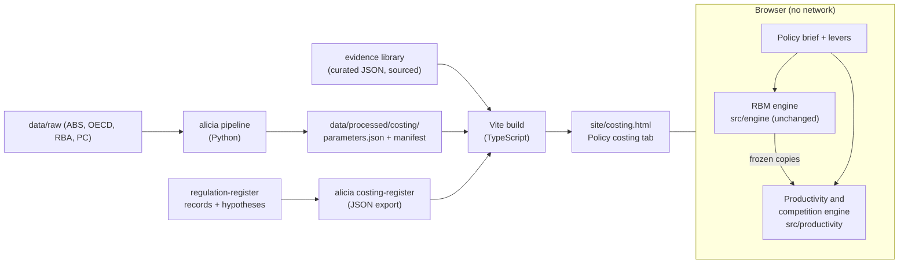

# Forward plan: prospective policy costing in ALICIA

Project plan and methods note, 22 October 2026, for the owner, Cowork and Claude Code. **Status: approved** (22 October 2026: every decision in §12 as recommended, `alicia/DECISIONS.md` E-77). **P0 is done** (§9).

**Goal:** a new, interactive **Policy costing** tab on the ALICIA website. A user describes a prospective Australian policy and gets two costings:

1. **A regulatory burden costing.** This follows the Office of Impact Analysis (OIA) *Regulatory Burden Measurement Framework* (July 2026) and uses the data already flowing into ALICIA.
2. **A productivity and competition costing.** It turns the policy brief into estimated effects on productivity, by channel and industry, and then on GDP. Each figure comes with a range, its sources and an evidence grade.

---

## 0. Summary

- **The change of direction.** The retrospective evaluation programme is **paused**. Each law would need its own identification strategy, and 12 evaluations have found no detectable primary effect (DECISIONS E-70, E-74). The register (171 records) and its hypotheses (direction, rationale, OECD/OIA competition channels) are **kept** and become part of the new tab (§6.9).
- **What gets built:** the existing regulatory burden calculator (`regulatory-burden-tool/`, Phases 1–2 complete) is folded into the ALICIA site as the new tab, with a new **productivity and competition engine** alongside it. That engine:
  - reads the burden results through the existing read-only extension interface;
  - adds its own policy levers;
  - never changes the regulatory burden estimate (RBE). The RBM excludes "changes to market structure and competition impacts" (RBM p. 4).
- **How it works:**
  - **Layer A** converts each lever into a direct shock by industry: a productivity, user-cost or entry-rate change. Each shock is an editable chain of factors, each factor with its source. This is the method the Productivity Commission (PC) used in its 2024 National Competition Policy modelling.
  - **Layer B** aggregates the shocks to GDP using a long-run closure calibrated against the PC's own 27 published CGE simulations.
  - Results are ranges, never point estimates alone.
- **Why it fills a gap:** the 2026 IA Framework asks for exactly this kind of analysis but gives no method.
  - Threshold 2 is "indicative impacts of $200 million or more a year on economic and social outcomes", including productivity (Practical Guide, p. 8).
  - The competition guidance asks agencies to "identify the direction and channels of impact".
  - It warns that "aggregate (economy-wide) effects … should be presented only if they are material and supported by robust evidence". The tool builds that warning in (§6.6).
- **The plan:** eight phases (P0–P7, §9), each with deliverables and acceptance tests.
- **Parked:** a literature review for each register record, testing the hypothesised competition and productivity impact. It is recorded in [`parked_items.md`](parked_items.md) (P-1), and the owner is reminded of it when P7 closes.

---

## 1. The change of direction

| Item | Status from 22 Oct 2026 |
|---|---|
| Retrospective evaluations (12 current, 8 archived) | **Paused.** They stay published, marked provisional. No new specifications. The due-diligence open items ([`due_diligence.md`](due_diligence.md)) are frozen, not abandoned |
| Register of changes (`regulation-register/`, 171 draft records) | **Kept.** Feeds the tab's reference class and competition checklist (§6.9) |
| Hypotheses (direction, rationale, sources, channels) | **Kept, and added to the product.** Each costing shows the register's hypotheses for similar past changes |
| Data pipeline and controls (`alicia/src/alicia/pipeline/`) | **Kept and extended** to supply costing parameters (§7) |
| Estimator library, power study, specification runner | Kept; dormant |
| Regulatory burden calculator (`regulatory-burden-tool/`) | **Resumed** (paused 14 Oct 2026, DECISIONS #79) and folded into ALICIA |
| Hambur & Freestone replication (`hf2025-replication/`) | Kept as an optional input to the mark-up channel (C6). Its Phase 1 plan still awaits approval (§12, D-8) |
| Literature review for each register record | **Parked** (P-1). The owner is reminded at the end of P7 |

---

## 2. What the frameworks require, and what they leave open

The OIA documents were read in full; the PDF hashes match those already recorded in `regulatory-burden-tool/data/SOURCES.md`.

| Requirement | Source | Consequence for the tool |
|---|---|---|
| An IA is required for "regulatory policy proposals, or proposals with material competition impacts" | IA Framework (July 2026) | Competition screening sits at the front of the workflow, not as an add-on |
| **Threshold 1:** "change regulatory burden by $20 million or more in total (over 10 years)" | Practical Guide p. 7 | Already implemented (`iaThreshold1TenYearTotal`) |
| **Threshold 2:** "indicative impacts of $200 million or more a year on economic and social outcomes"; covers "economic growth, household income, investment, innovation and productivity"; no discounting for the preliminary test | Practical Guide p. 8 | The productivity costing reports an annual $ effect against $200m, undiscounted, with its range |
| **Threshold 3:** proposals likely to "disproportionately and significantly impact a cohort, including small businesses" | Practical Guide p. 9 | Cost-to-revenue by size cohort, and the small-to-large cost ratio (§6.8) |
| IA question 4 (net benefit): assess "economic, competition, social, environmental or other impacts"; burden under the RBM; "quantify impacts where possible" | IA Framework | The two costings map onto question 4 |
| RBM: work time $52.31 × 1.75 = **$91.54/h**; non-work time **$41/h**; 10 years, real, "Discount rates are not to be applied"; indirect and competition impacts excluded | RBM pp. 4, 6, 12–13 | Engine unchanged. Productivity and competition sit outside the RBE (DECISIONS #44) |
| Competition tests: Step 1, does it impact competition (five categories "broadly based on" the OECD *Competition Assessment Toolkit*); Step 2, less restrictive alternatives; Step 3, net benefit. Costs "may need to be described in qualitative terms" | *How to consider competition in impact analysis* (July 2026) | The competition screen (§6.8) follows these three steps. The register's channels already use the Step 1 categories |
| Productivity: "identify the direction and channels of impact, such as resource allocation, innovation or efficiency. Where aggregate (economy-wide) effects are claimed, these should be presented only if they are material and supported by robust evidence" | Competition guidance | The materiality and evidence gate (§6.6) |
| Cost–benefit analysis: net present values at "an annual real discount rate of 7 per cent", with 3% and 10% sensitivity | OIA CBA guidance note (2023, marked as under review) | Net present values at 7% (3%, 10%) for the productivity stream, kept separate from the undiscounted RBE |

**What no framework supplies:** a way to turn a policy's features into a quantified productivity effect. The research for this plan found:

- **Australia:** the PC's 2024 NCP modelling is the closest precedent. It builds each shock as a chain of factors (Table C.5 onwards).
- **NZ:** the Treasury's CBAx tool attaches an evidence grade to a library of monetised impacts.
- **The rest of practice** (UK, EU, NZ RAS, US A-4) stops at checklists, cost-to-sales screens and qualitative competition assessment, consistent with the scoping note ([`econometric_foundation_scoping.md`](econometric_foundation_scoping.md) §1).

**Policy context:**
- The PC's *Creating a more dynamic and resilient economy* (released 19 Dec 2025) recommends a target to cut Commonwealth "compliance and delay costs" by $10bn by 2030. It estimates those costs at $115–160bn a year, but publishes **no GDP translation**.
- The 2026–27 Budget claims a $10.2bn a year **gross** reduction in regulatory burden.
- Neither has a productivity costing method. That is the tool's opening.

---

## 3. The product: the Policy costing tab

### 3.1 User journey

| Step | Page | What the user does | What the tool shows |
|---|---|---|---|
| 1 | **Brief** | Title, summary, jurisdiction, proposal type (new, reform, repeal), start year, phase-in. Optionally paste a policy brief and use the copy-and-paste drafting prompt (§5.3) | Similar past changes from the register (§6.9) |
| 2 | **Scope** | Affected industries (ANZSIC, with an exposure share), size bands, entity types, states | Business counts, employment, GVA and entry/exit rates for the chosen scope (CABEE, Australian Industry, ASNA) |
| 3 | **Regulatory burden** | Obligations, using the existing builder (current regime, reform options, levers) | RBE table, 10-year total, IA threshold 1 |
| 4 | **Productivity levers** | One card per channel (§6.2); only the relevant cards are filled in | Each card's Layer A shock chain with defaults, sources and evidence grade |
| 5 | **Competition screen** | Answers to the OIA Step 1 questions (pre-filled from levers and register matches) | Cost-to-revenue by cohort, small-to-large ratio, threshold cliffs, Step 2 option comparison |
| 6 | **Results** | Chooses range, horizon, discount rate, realisation factor | (a) Burden: RBE, by cohort, IA thresholds 1 and 3. (b) Productivity: effect on MFP and labour productivity by channel × industry × year; GDP level (% and $ a year, 2025-26 dollars) at 5 and 10 years and in the long run; low/central/high; threshold 2 check; evidence grade; sensitivity (tornado) chart. (c) What is not quantified |
| 7 | **Export** | Save and load (local only), copy as text | Tidy CSV, a JSON proposal, and a methods appendix to paste into an IA |

### 3.2 Principles

1. **The RBE stays pure.** The productivity engine reads frozen copies of the burden results and never writes back.
2. **Ranges by default.** The central figure is never shown without its low and high.
3. **Every number traces to a source.** Each parameter shows its citation, a quote or table reference, the country, the method and an evidence grade. Where a parameter is the tool's own assumption, it says so.
4. **Efficiency is kept apart from transfers.** Lower prices from removed rents are not GDP gains (PC 2017; PC 2024). Price, GDP and income effects are reported separately.
5. **Burden savings are kept apart from GDP effects.** Compliance-cost arithmetic is partial equilibrium. The step to GDP is a separate, labelled calculation.
6. **No headline creep.** Each exported figure carries its bound (lower, central, upper), method tag and key assumption. For example, the Government's figure for the non-compete ban ("$5 billion or 0.2 per cent to GDP") is the PC's *upper* bound, which assumed 10% pass-through of a US wage effect.
7. **Privacy.** Proposal files may be Cabinet-in-confidence. The built page makes no network calls (`connect-src 'none'`, DECISIONS #37). Parameters are bundled at build time, and saved proposals stay in the browser or a local file (gitignored patterns kept).

---

## 4. Architecture

| Component | Location | Language | Change |
|---|---|---|---|
| RBM engine | `regulatory-burden-tool/src/engine/` | TypeScript | Unchanged except data-driven population defaults (provenance `sourced`) |
| Productivity and competition engine (PCE) | `regulatory-burden-tool/src/productivity/` (new) | TypeScript | New. Pure functions, decimal.js, zod schemas, its own traceability table |
| Evidence library | `regulatory-burden-tool/src/productivity/evidence/*.json` (new) | JSON + zod | New. Curated by Claude Code, reviewed by Cowork |
| Parameter export | `alicia/src/alicia/costing/` (new), command `alicia costing-params` | Python | New. Reads processed panels; writes `data/processed/costing/parameters.json` with a manifest (vintages, SHA-256s) |
| Register export | `alicia costing-register` | Python | New. Records, hypotheses, channels, industries and evaluation verdicts as one JSON |
| Site integration | `alicia/src/alicia/menu/growth.py` (`PAGES`, `nav`), Pages workflow | Python, YAML | Add "Policy costing" to the nav. The Vite build writes `site/costing.html` and its assets. The workflow gains a Node step (`npm ci`, `npm run build:site`) |
| Calibration and back-test scripts | `alicia/analyses/costing_calibration/` (new) | Python | New. Reproduces the PC National checks (§8) from raw files |

**Why TypeScript for the new engine:**
- The tab is a static page with no server, and the costing must run in the browser.
- The RBM engine is already TypeScript, with 2,425 lines and tests.
- CLAUDE.md makes R the default. Python is approved for `alicia/` (owner decision, 18 Oct 2026). The burden tool's TypeScript predates that rule.
- **Flagged for the owner (§12, D-2).** The calibration scripts stay in Python, and an R cross-check of the Layer B back-test can be added once R is installed.

---

## 5. Inputs: the policy brief

### 5.1 Schema (`PolicyBrief` v1, zod, strict)

| Block | Fields | Notes |
|---|---|---|
| `meta` | id, title, summary, jurisdictions, proposalType (new, reform, repeal), startYear, phaseIn (years to full effect), durationYears (default 10), baseline | Reuses the RBM proposal's fields where they exist |
| `scope` | industries [{anzsic (division to class), exposure 0–1, direct or indirect}], sizeBands (ABS employment bands), entityTypes, states | Same keys as the RBM `PopulationSchema` and the register's `industries` |
| `burden` | The existing RBM `Proposal` | Required for C1 and C2; optional otherwise |
| `levers.entry` | Per-entrant one-off cost ($), approval time (days), cap on numbers (yes or no; size of cap), qualification requirement, exit cost change | Feeds C4 (entry barriers) and C2 (delay) |
| `levers.threshold` | Size metric (employees, turnover, payroll), threshold value, cost per firm above it, phase-out design (cliff or taper) | C5 |
| `levers.capital` | Change in company tax rate, depreciation rules (PV of deductions z), investment approval delay, risk premium | C3 |
| `levers.conduct` | Price or quantity controls, advertising limits, standards, trading-hours rules, exclusivity, information requirements; each as a stringency change on the PMR scale or a user-entered mark-up change | C6 / C7 |
| `levers.labour` | Licensed occupations affected (OSCA codes), stringency change, mutual recognition, non-compete coverage | C8 |
| `levers.innovation` | R&D tax-price change, product-approval time | C9 |
| `levers.trade` | Tariff change, FDI screening threshold, services trade restriction | C10 |
| `levers.fiscal` | Revenue raised or forgone a year, funding tax | C11 |
| `levers.custom` | User-entered shock: industry, type (MFP, labour productivity, price, rent), size, source, justification | Escape hatch. Graded D unless sourced |
| Provenance on every input | `default`, `entered`, `description`, `modelEstimate`, `sourced` | Reuses `ProvenanceSchema` (DECISIONS #58). Unconfirmed model estimates watermark the results (#59) |

### 5.2 Defaults from data

Choosing the scope fills each lever's baseline from `parameters.json`, labelled `sourced` with the release:

- number of businesses by industry × size band (CABEE);
- employment, wages, sales and value added (Australian Industry 8155.0);
- GVA, capital stock and factor shares (ASNA 5204.0, MFP 5260.0.55.002);
- entry and exit rates (CABEE).

### 5.3 From a written brief to inputs

The copy-and-paste drafting assistant (deferred Phase 2b; the engine groundwork is done) is extended to the whole brief:

1. The tool generates a prompt containing the schema.
2. The user pastes it, with their policy brief, into an AI tool of their choice.
3. The user pastes the reply back. It loads through the checked `importDraft` path.
4. Every drafted value is marked `modelEstimate` until the user confirms it.

There is **no direct connection** to an AI service (DECISIONS #61), so nothing leaves the browser unless the user copies it.

---

## 6. Productivity and competition costing: method

### 6.1 Two layers

- **Layer A (direct effect by industry):** each lever becomes one or more shocks
  s_{i,c,t} (industry i, channel c, year t), each of a stated type:
  - Hicks-neutral MFP;
  - labour-augmenting productivity;
  - user cost of capital;
  - entry rate;
  - mark-up.
- Each shock is a **chain of factors**, for example: share of firms affected × cost per firm ÷ industry GVA × pass-through. Each factor is shown, editable and sourced. This copies the structure of PC 2024, Tables C.5–C.9.
- **Layer B (economy-wide):** shocks are aggregated to GDP with a reduced-form long-run closure (§6.3) calibrated against the PC's CGE results. The tool reports the direct (Layer A) and economy-wide (Layer B) figures side by side.

### 6.2 Channels

Evidence grades:
- **A:** Australian causal or structural estimate.
- **B:** international causal estimate.
- **C:** a correlation (across countries or within one, e.g. an Australian panel correlation), or a model result used as a rule of thumb.
- **D:** the tool's assumption, or a user entry.

Verification tags:
- **[P]:** read in the primary source.
- **[A]:** read in the abstract or official summary.
- **[S]:** from secondary coverage only, and never used as a default.

| # | Channel | Levers | Layer A formula | Default parameters (grade, tag) | Data |
|---|---|---|---|---|---|
| C1 | **Resource cost of compliance** | RBM obligations | Labour and purchases used for compliance produce no measured output: Δln MFP_i ≈ −ΔC_i / GVA_i (derived), where ΔC_i is the RBE's annual change in compliance cost allocated to industry i; fees and taxes excluded (already outside the RBE) | None needed: the RBE is the input. Share of substantive compliance producing unmeasured benefits: user-set, default 0 (D) | RBE tidy rows; GVA by industry (5204.0, 8155.0) |
| C2 | **Delay and approval time** | RBM delay costs; approval time for entry or investment | A delay of d years raises the effective price of capital: Δln c ≈ r·d (derived), then C3. Delay costs already in the RBE are not counted again | r: user-set, default 7% real (OIA CBA rate). PC 2025 (net zero) cites a holding cost of about $20m a year on $400m raised (≈5%) (C, [P]) | CAPEX by industry; approval times entered by the user |
| C3 | **Capital deepening (user cost)** | Company tax, depreciation, risk, delay | Hall–Jorgenson user cost c = q(r + δ)(1 − τz)/(1 − τ); Δln K = −σ·Δln c; Δln LP = α·Δln(K/L). Long-run capital adjusts at a fixed rate of return (§6.3) | σ = 0.40 (Chirinko, Fazzari & Meyer 2011; B, [A]); Treasury model 0.9, range 0.4–1.4 (Kouparitsas et al. 2016; C, [P]); capital share α by industry (5260.0.55.002 Table 14; market-sector two-period average ≈ 0.45 in 2024-25, Table 2) | MFP tables 12 and 14; ASNA capital stock; CAPEX |
| C4 | **Entry and exit barriers** | Per-entrant cost, cap on numbers, approval time, exit cost | Step 1: change in entry rate (derived mapping). Δentry_i = ε·Δ(entry cost_i / GDP per capita), with ε from Klapper, Laeven & Rajan: cutting entry cost from 20% to 8% of GNP per capita raises the entry rate of naturally high-entry industries, relative to others, by 0.5 pp (B, [P]). It is a cross-industry difference, so it applies only to industries with naturally high entry. A cap on numbers binds directly. For scale, Australia's entry cost was 2.25% of GDP per capita (Djankov et al. 2002; [P]). Step 2: entry to productivity growth through faster catch-up to the frontier, Δg_i = β₂·Δentry_i·gap_i, with β₂ = 0.009 per pp of entry rate (Andrews, Hambur, Hansell & Wheeler 2022; C, [P]: an Australian panel correlation, A-P17) | Entry rates by industry (CABEE 2025-26: 16.9% overall); frontier gap by division: **not public** (BLADE), and the paper publishes no sample mean, so the gap is user-set (A-P12) | CABEE entries and exits; Australian Industry revenue per firm by size |
| C5 | **Size thresholds** | Threshold design, cost above it | Screen: count firms within ±10% of the threshold (CABEE size bands; turnover bands from ATO). Quantify only as an implicit tax on growth, with a bounded range from Garicano, Lelarge & Van Reenen 2016 (a 2.3% labour-tax equivalent costs 1.3–3.4% of GDP in France; B, [A]) and Gourio & Roys 2014 (under 0.3% of output per worker; B, [A]), scaled by the share of employment near the threshold | Australian bunching evidence: SA payroll tax threshold, +21% just below and −18% just above (e61 2024; A, [P]); Treasury 2018 found little bunching at payroll tax thresholds (A, [A]) | CABEE size bands; ATO taxation statistics by turnover band |
| C6 | **Competition intensity and mark-ups** | Rules on how firms compete; caps; conduct rules | Δ mark-up → misallocation loss of TFP. Default mapping from Hambur & Freestone 2025: a mark-up rise from 1.18 to 1.25 (harmonic) raised the value-added misallocation cost by 1.16–2.52 pp (A, [P]). The tool interpolates within that range and never extrapolates beyond it. Optionally replaced by `hf2025-replication` outputs once its Phase 1–2 are done | Division mark-ups 2004–2017 and concentration 2002–2019 (H&F supplementary data, BLADE-derived; in `hf2025-replication/`). Firm-level mark-ups **cannot** be estimated from public data | RBA RDP 2025-05 supplementary zip |
| C7 | **Product market regulation (PMR) indicator route** | Change in OECD PMR or ETCR sub-indicator answers | Δln MFP_LR = β·ΔETCR, β = −0.037 to −0.047 per index point; capital/output (K/Y) effect −0.035/−0.025; the 5-year effect is about one-third of the long run (Égert & Gal 2016; C, [P]; the paper itself warns the ETCR coefficient "has large standard errors" with year effects) | Australia 2023 PMR: economy-wide 1.35; barriers in service sectors 1.91; administrative and regulatory burden 2.31 (OECD SDMX; [P]) | OECD PMR 2018 and 2023 (SDMX `DSD_PMR@DF_PMR`) |
| C8 | **Labour mobility** | Occupational licensing stringency, mutual recognition, non-competes | Labour-augmenting productivity shock in affected industries. Licensing: OECD elasticity used by the PC (a 1-unit stringency cut → +1.6% labour productivity; the PC assumed a 0.5-unit cut → +0.8%) (C, [P]). Non-competes: 10% pass-through of Johnson, Lavetti & Lipsitz wage effects (labour productivity +0.24% in 24 service industries, +0.14% elsewhere), the PC's upper case (C, [P]) | 24% of workers are in risk-classified licensed occupations (PC; [P]); OSCA 2024: 187 occupations require a licence, 196 may (ABS; [P]) | OSCA licensing flags; LFS EQ08/EQ09 (last edition March 2026) |
| C9 | **Innovation and R&D** | R&D tax price; product-approval time | Δln R&D = ε·Δln(R&D user cost), with ε ≈ −0.1 short run and ≈ −1 long run (Bloom, Griffith & Van Reenen 2002; B, [A]). Then Δ MFP from Δ(R&D/GDP), using Égert & Gal's +0.10 pp of business R&D → GDP per capita +0.46% in the long run (C, [P]). Australian additionality: $0.8–1.9 of R&D per $1 forgone (Swinburne/Holt et al.; D until verified, [S]) | Social return 55% vs private 21% (Bloom, Schankerman & Van Reenen 2013; B, [P]), for context only | BERD 8104.0 by subdivision × size |
| C10 | **Trade and foreign investment** | Tariffs, FDI screening, services trade restrictions | Δln MFP = 0.006–0.008 × Δopenness (pp of GDP) (Égert & Gal; C, [P]). Tariff removal checked against the PC 2024 result (GDP +0.13–0.25%; A, [P]) | FDI: a 10% cut in the restrictiveness index → +2.1% bilateral FDI stocks (Mistura & Roulet 2019; C, [P]); no verified FDI → MFP elasticity, so FDI effects are reported as investment only | OECD STRI 2025 and FDI RRI 2025 |
| C11 | **Fiscal: efficiency cost of funding** | Revenue raised or forgone | Excess burden = revenue × marginal excess burden (MEB) of the funding tax (Cao et al. 2015, Treasury WP 2015-01: company 0.50, range 0.20–1.35; labour income 0.21; GST 0.19; personal income 0.16; conveyancing duty 0.72; land −0.10) (A, [P]) | KPMG 2010/2011 MEBs as sensitivity (C, [P]) | None |
| C12 | **Other** (agglomeration, public capital, human capital) | User-entered shock only (v1) | Not modelled in v1 | Listed for later: agglomeration elasticity 2.7–6.4% (Donovan et al.); public capital output elasticity 0.083 short run, 0.122 long run (Bom & Ligthart) | — |

**Gaps that cannot be filled from public data**, shown in the tool where they bind:
- frontier productivity gaps;
- firm-level mark-ups;
- bunching at the 15-employee unfair dismissal, $75k GST and $10m small business entity thresholds (no verified Australian study found).

### 6.3 Layer B: from industry shocks to GDP

**Long-run closure** (default, about 10 years). It matches the PC National closure in PC 2024:
- fixed aggregate employment;
- fixed rate of return, so capital adjusts.

| Shock type | Aggregation (derived) |
|---|---|
| Labour-augmenting productivity x_i | Δln Y ≈ Σ_i (W_i / W) · x_i, with W_i the industry wage bill (I-O Table 17 or ASNA 5204 Table 46). Economy-wide x gives Δln Y = x, matching the PC's illustrative "0.1% LP economy-wide → +0.10% GDP" |
| Hicks-neutral value-added MFP z_i | Δln Y ≈ Σ_i (GVA_i / GDP) · z_i / (1 − α), with α the capital share |
| User cost (C3) | Through capital deepening in the affected industries, then as above |
| Entry-driven growth (C4) | Cumulated year by year over the horizon, then as for MFP |

**Calibration and back-test** (P4, `alicia/analyses/costing_calibration/`): run Layer B on the shocks of every PC National simulation in the published workbook (27 scenario tabs plus lower bounds and linearity tests), compare with the PC's real GDP results, and publish the errors.

**A scratch check** of the PC's L2 (licensing) simulation already shows why the weights matter. It applied +0.8% labour productivity to 15 industries that make up 34.4% of GSP (2018-19 workbook data), and real GDP rose 0.387%.
- **GVA weights:** an implied multiplier of 1.41.
- **Wage-bill weights:** expected to be close to 1, because health, education and construction are labour-intensive.

The P4 script will test this properly. The scratch figure is not a result.

**Time path:**
- Shocks phase in over the policy's `phaseIn`.
- Capital adjusts at the error-correction speeds in Égert & Gal (MFP and K/Y about −0.03 to −0.05 a year). Their 5-year, 10-year and long-run pattern (ETCR reform: +0.72%, +1.02%, +2.09%) is the default.
- Reported points: years 1, 5 and 10, and the long run.

**Outputs:**
- GDP level effect in % and $ a year (2025-26 dollars, ASNA 2025-26 once released on 23 Oct 2026).
- GDP per person.
- Net present value at 7% (3%, 10%) over the RBM duration.
- The threshold 2 check (central and low against $200m a year).

**Not modelled in v1:**
- GNI, terms of trade, CPI and state GSP.
- Each result names which of these could differ materially. GNI gains can be much smaller than GDP gains when foreign owners capture capital income. In Treasury WP 2016-02, a company tax cut raised GDP by 1.2% but GNI by 0.8%.

### 6.4 Uncertainty

- Every parameter has low, central and high values (from the source's own range or confidence interval; otherwise ±50%, graded D).
- **Monte Carlo:** seeded, deterministic, 2,000 draws, triangular distributions. It reports the 10th, 50th and 90th percentiles and a tornado chart of the top ten parameters.
- **Realisation factor:** user-adjustable, default 1.0. The tool notes that the Industry Commission's 1995 ex ante projection for the NCP reforms (+5.5% of GDP) was more than twice the PC's 2005 ex post estimate (+2.5%). The two are not strictly comparable: the 2005 figure covers seven infrastructure sectors and includes non-NCP factors.
- **Reverse mode:** what shock would make the proposal break even, or cross threshold 2?

### 6.5 Overlap rules (no double counting)

| Pair | Rule |
|---|---|
| C1 and C4 | The per-firm compliance cost feeds both. C1 counts the resource cost to incumbents; C4 counts only the change in entry. The tool shows both, and sums them only after subtracting the entrants' compliance cost from C1 |
| C2 and C3 | Delay costs already in the RBE are excluded from the user-cost shock |
| C6 and C7 | Alternative routes to the same effect. **One per policy** (C7 for network sectors covered by ETCR; C6 otherwise) |
| C8 and C4 | A licensing change is costed in C8; its entry-cost part is not costed again in C4 |
| C3 and C11 | A tax change's investment effect is in C3; its funding cost is in C11. They are reported separately and netted |
| Any channel and `custom` | A custom shock in an industry and channel that already has a modelled shock needs an explicit "replaces" or "adds to" choice |

### 6.6 The materiality and evidence gate

This follows the competition guidance: economy-wide effects are presented "only if they are material and supported by robust evidence".

| Condition | What is shown |
|---|---|
| Central GDP effect ≥ $200m a year and the largest channel graded A or B | Economy-wide results in full, with range |
| Below $200m a year, or the largest channel graded C | Economy-wide results marked **indicative**. Direct (Layer A) results in full |
| Largest channel graded D, or unconfirmed model estimates | Direction, channels and Layer A arithmetic only; the GDP figure is hidden unless the user opts in. A watermark is added (as for DECISIONS #59) |

### 6.7 Evidence library

One JSON entry per parameter: id, channel, parameter, value, low, high, units, country, method (causal, structural, correlational, model), grade, verification tag, citation, URL, page or table, an exact quote, and notes.

- **Seed entries:** the [P] and [A] values in §6.2.
- **Verification:** each entry is checked against its source by Cowork before release. [S] items are never defaults.
- **Display:** the library is shown in the tab ("Sources and parameters") and exported with every costing.

### 6.8 The competition screen

| OIA step | Measures | Sources |
|---|---|---|
| **Step 1: does it impact competition?** | The five categories, pre-ticked from the levers (and from register matches with the same channels); compliance cost as a share of revenue by size cohort; **small-to-large cost ratio**; firms near any threshold; share of the market's firms affected | RBE by cohort; Australian Industry revenue by size; CABEE |
| **Step 2: less restrictive alternatives** | The same measures across the proposal's options (the RBM engine already holds several options) | RBM options |
| **Step 3: net benefit** | The productivity costing (§6.1–6.6) beside the RBE and any benefits the user enters, with the non-quantified items listed | This plan |

**Prior for the incidence of burden by firm size:** the 2024-25 Business Characteristics Survey found that 20.2% of all businesses report "government regulations and/or compliance" as a barrier. By size: 17.3% (0–4 persons), 24.2% (5–19), 28.2% (20–199) and 29.1% (200+). By division, from 33.4% (agriculture) down to 14.3% (other services).

The scoping note (§3) warns that compliance cost may peak at mid-sized firms. The tool shows the measured incidence, not an assumed one.

### 6.9 The register in the product

- **Similar past changes:** register records ranked by shared channels, industries (ANZSIC prefix match) and jurisdiction type. Each shows:
  - the hypothesised direction and rationale, with its sources;
  - the channels;
  - the commencement date;
  - the evaluation verdict, if any, labelled provisional with a link to its page.
- **A direction check:** if a lever's sign disagrees with the register's hypothesis for most similar changes, a note asks the user to confirm.
- **Not used as parameters:** retrospective estimates are not used as elasticities. They are underpowered and provisional ([`due_diligence.md`](due_diligence.md)), though an evaluation with a precise null is shown as context.
- **The checklist vocabulary:** the register's five channels (`barriers`, `number-or-type`, `ability-incentive`, `prices-market-share`, `consumer-choice`) are the OIA Step 1 categories, so the same words appear in both places.

---

## 7. Data and parameters

ABS has **no Data API dataflow** for industry MFP, the annual ASNA industry tables, input–output tables, CABEE entries and exits, EEH or BERD (all 1,229 ABS dataflow IDs checked, 22 Oct 2026). These come as XLSX downloads, through connectors that record checksums like the existing ones.

| Source | Use | Granularity | Access | Pipeline | Release |
|---|---|---|---|---|---|
| ABS CABEE 8165.0 | Business counts and entry/exit by industry × size | Class × state × size (cube 2) | XLSX | **In pipeline**, to the 2021–25 release | Jul 2022–Jun 2026: cube 1 out 18 Aug 2026; cube 2 due 18 Dec 2026 |
| ABS Industry MFP 5260.0.55.002 | MFP, labour productivity, capital services, productive capital stock, income shares (Tables 12, 14, 19, 25) | 16 market-sector divisions | XLSX | New | 2024-25 (6 Feb 2026); next 19 Feb 2027 |
| ABS ASNA 5204.0 | GVA, compensation of employees, gross operating surplus, net capital stock by industry (Tables 5, 46, 48, 58, 63) | 19 divisions | XLSX | New (State Accounts already in) | 2025-26 due **23 Oct 2026** |
| ABS Australian Industry 8155.0 | Employment, wages, sales, value added, profit by subdivision; by size × division (Table 5) | Subdivision; size × division | Data API `AUSTRALIAN_INDUSTRY` 1.1.0 (no size) + XLSX | New ("To do" in `data/SOURCES.md`) | 2024-25 (19 Jun 2026) |
| ABS Input-Output 5209.0.55.001 | Wage-bill and GVA weights by industry; Leontief inverse for supply-chain pass-through (ABS has not published multipliers since 1998-99) | 115 IOIGs | XLSX | New | 2023-24 (25 Mar 2026) |
| ABS Business Characteristics (BCS) | Regulation as a barrier, by size and industry; innovation | 4 size bands, division | XLSX (2024-25) | New | 2024-25 (25 Jun 2026); now biennial |
| ABS EEH 6306.0; AWE 6302.0; WPI | Rate sensitivity by industry and employer size (EEH May 2025: $43.00/h at under 20 employees to $59.60/h at 1,000+, before tax); indexation | Division, employer size | XLSX; Data API `AWE`, `WPI` | WPI totals in pipeline; EEH, AWE new | EEH May 2025 (23 Jan 2026) |
| ABS CAPEX 5625.0; QBIS 5676.0 | Investment and profit baselines | Division (CAPEX partly subdivision) | Data API `CAPEX`, `QBIS` | QBIS in pipeline; CAPEX new | June 2026 |
| ABS BERD 8104.0 | R&D by subdivision × size | Subdivision × size | XLSX | New | 2023-24 |
| ABS OSCA 2024 + LFS EQ08/EQ09 | Licensed occupations and their employment | Occupation | XLSX | New (EQ06 in pipeline) | OSCA v1.0; LFS Detailed ceased after March 2026 |
| ABS Labour Account | Hours by subdivision (LP denominators) | Subdivision, quarterly | Data API `LABOUR_ACCT_Q` | New | To 2026-Q2 |
| OECD PMR 2018/2023, STRI 2025, FDI RRI 2025 | C7, C10 baselines | Economy-wide and sector | OECD SDMX | New | Values pulled 22 Oct 2026 |
| RBA RDP 2025-05 supplementary | Division mark-ups 2004–2017, concentration 2002–2019 (C6) | Division | ZIP | In `hf2025-replication/` | Aug 2025 |
| PC 2024 PC National results workbook | Layer B calibration and back-test | 114 industries, states | XLSX | New (consulted 22 Oct 2026) | Released 29 Nov 2024; licence of the workbook to be confirmed |
| ATO Taxation Statistics 2023-24 (incl. cost of compliance tables COC 1–3) | Turnover bands near thresholds (C5); tax compliance hours (validation of RBM inputs) | Fine industry; turnover band | XLSX via data.gov.au | New ("To do") | 21 Apr 2026 |
| OIA published Impact Analyses | RBM validation cases | Per proposal | PDF/DOCX only | New (hand-picked) | Ongoing |

**Not available publicly:**
- firm-level mark-ups, productivity dispersion and frontier gaps (BLADE, restricted; never committed);
- licence-holder counts;
- the OECD Productivity Database by industry (queries failed, HTTP 500, 22 Oct 2026).

**Parameter file contract** (`data/processed/costing/parameters.json`):
- One object per source, carrying: `vintage`, `release_date`, `url`, `sha256`, `licence`, and tidy rows keyed by ANZSIC code and size band.
- Built only by `alicia costing-params` from `data/raw/` through `data/processed/`.
- Tests check every key the TypeScript schema needs.
- Every new source is recorded in `data/SOURCES.md` in the same commit.

---

## 8. Validation

| Check | How | Pass mark |
|---|---|---|
| RBM engine | Existing tests, traceability check (`npm run check`) and the end-to-end suite | Unchanged, all pass |
| RBM against published IAs | Re-cost 3–5 published Impact Analyses with clear burden tables (burden tool Phase 5) | The reproduced RBE matches the published figure, or each difference is explained |
| Channel formulas | Unit tests per channel: hand-worked examples, zero levers → zero effect, monotonic in each lever, linear where the source is linear | All pass |
| Layer B back-test | Feed the shocks of every PC National simulation into Layer B and compare real GDP (`alicia/analyses/costing_calibration/`) | Errors published per simulation. Target within ±15% for pure productivity shocks; rent and tariff simulations reported, not targeted |
| Reproduce PC shock chains | L1 (non-competes), L2 (licensing), B7tar (tariffs and compliance costs), H5 (telehealth hours) rebuilt as Layer A chains | Shocks match PC Tables C.5–C.9 exactly |
| External anchors | Company tax 30% → 25% (Treasury WP 2016-02: GDP +1.2% long run); PC 2025 company tax package (GDP +0.4 to +0.7%) | Layer B within the published model range, or the gap explained (CGE effects not in the reduced form) |
| Worked examples | Five briefs costed end to end: the non-compete ban; automatic mutual recognition; a new reporting obligation with a size threshold; an approval-time cut for investment; a payroll-tax threshold change | Each has a short methods note in `docs/` and a regression test that freezes its output |
| Evidence library | Cowork checks every entry against its source (quote, page, value) | No unverified default |
| Accessibility and privacy | axe checks; CSP test (no network); proposal patterns gitignored | Pass |

---

## 9. Phases

| Phase | Deliverables | Acceptance | Depends on |
|---|---|---|---|
| **P0. Decisions and specification** | This plan; owner decisions (§12); a traceability table for the productivity methods (`regulatory-burden-tool/docs/productivity_traceability.md`: each formula, its source and its test); the `PolicyBrief` schema in zod | Decisions recorded in both DECISIONS logs | — |
| **P1. Fold-in** | The burden tool built as `site/costing.html` with the ALICIA nav; "Policy costing" in `PAGES`; the Pages workflow gains a Node build; shared design tokens; CSP kept | Site builds locally and in CI; existing unit and end-to-end tests pass on the folded page; nav works across all pages | P0 |
| **P2. Parameter pipeline** | Connectors for MFP 5260, ASNA 5204 (2025-26), Australian Industry 8155 (API + size tables), I-O 2023-24, BCS 2024-25, EEH/AWE, CAPEX, BERD, OSCA + LFS EQ08/EQ09, OECD PMR/STRI/FDI RRI, the PC National workbook; `alicia costing-params`; `alicia costing-register`; `data/SOURCES.md` entries | `parameters.json` rebuilds byte for byte; schema tests pass; every source recorded | P0 |
| **P3. Evidence library** | Seed entries (§6.2), with quotes and pages; a zod schema; the "Sources and parameters" page; a Cowork verification sheet (`docs/review/evidence_library_review.csv`) | Every default entry [P] or [A] and checked by Cowork | P0 |
| **P4. Productivity engine and calibration** | `src/productivity/`: Layer A channels C1–C11, Layer B closure, time path, Monte Carlo, overlap rules, gate; a CLI (`npm run pce -- brief.json`); the calibration and back-test scripts | Unit tests; back-test errors published in `docs/costing_calibration.md`; PC shock chains reproduced | P2, P3 |
| **P5. User interface** | Brief, Scope, Levers, Competition screen and Results pages; charts (by channel, industry and year; range bands; tornado); similar past changes; exports; burden tool Phase 3 items (screener UI, warnings UI, assumptions register, option comparison) | End-to-end and accessibility tests; works at phone width; no network | P1, P4 |
| **P6. Validation** | RBM re-costings of published IAs; the external anchors; the five worked examples with methods notes | §8 pass marks met, or the gaps explained in the notes | P4, P5 |
| **P7. Drafting assistant, guide, release** | Copy-and-paste brief-to-inputs prompt; a user guide; Cowork guide for writing up a costing; exports (CSV, JSON, methods appendix); a release note | The owner signs off a release | P5, P6 |
| **After P7** | **Remind the owner of parked item P-1** (literature review for each register record; [`parked_items.md`](parked_items.md)) | Owner decides whether to start it | P7 |

**Progress (22 October 2026):**

| Phase | State |
|---|---|
| P0 | **Done.** Decisions approved (E-77; burden tool #83). Policy brief schema v1 in `regulatory-burden-tool/src/productivity/brief.ts` (with channels, overlap rules and ANZSIC helpers), 16 tests (T-BRF-01 to 16) and an illustrative example brief. [`productivity_traceability.md`](../regulatory-burden-tool/docs/productivity_traceability.md) specifies every formula with its source, and `npm run trace` checks it |
| P1 | **Done** (22 Oct 2026; E-78, burden tool #86). Policy costing tab on the website (`npm run build:site`, `alicia site --costing`), site nav and theme, bundled parameters, data list on the About page; the Pages workflow refreshes the costing data daily from the publishers' latest releases and republishes |
| P3 | **Done** (23 Oct 2026; burden tool #87). Evidence library of 60 sourced entries (48 defaults), Sources and parameters page, Cowork review sheet and guide (`docs/review/evidence_library_review*.{csv,md}`). A-P17 resolved: AHHW2022's β₂ graded C (owner, 23 Oct 2026) |
| P2 | **Done** (23 Oct 2026; E-79). `alicia costing-params` builds `data/processed/costing/parameters.json` from 16 sources and 33 tables ([data dictionary](costing_parameters.md)): • ABS: ASNA (**2025-26**, released 23 Oct 2026 and picked up by `--refresh` on the day), MFP, Australian Industry, CABEE, I-O, EEH, BCS, BERD, OSCA, CAPEX, ANZSIC; • OECD PMR, STRI and FDI RRI; • the PC National results; • the RBA's division mark-ups and concentration. `alicia costing-register` exports the register (171 records). `--refresh` checks each publisher and downloads only what changed |
| P4 | **Done** (24 Oct 2026). Done: • Layer B, back-tested against PC National ([results](costing_calibration.md); E-80, burden tool #89). 6 of 10 targets are within ±15%; health-care-only shocks are overstated; the back-test's model-error band is Layer B's range (A-P19); • Layer A channels C1–C3 and C6–C11, custom shocks and the costing engine, at central values (burden tool #90). The engine reproduces the PC's L2 and L1; • the time path, NPVs, Monte Carlo ranges with the model-error band, the tornado, the evidence gate, overlap rule O-2 and the CLI `npm run pce` (burden tool #91); • C4 (entry, with a productivity effect when the user enters the frontier gap), the C5 screen, overlap rules O-1 and O-4, GDP per person; ASNA Table 1 added to the parameters (burden tool #92, E-81). Owner decisions (25 Oct, burden tool #93): the tool's own assumptions set ranges, not grades (A-P31); C5 reports a screen without a GDP effect in v1 (A-P05) |
| P5 | **Done** (25 Oct 2026; burden tool #94). Seven steps: Proposal (with the brief's timing and jurisdictions), Scope, Current regime and Reform options (with the scope screener), Productivity levers, Competition screen, Results. The levers page shows each channel's calculation, evidence and grade, and similar past changes; the Results page adds the productivity costing with its gate, ranges, time path, present values, charts and a CSV; the competition screen follows the OIA's three steps. The whole costing saves as one `.brief.json`. End-to-end, accessibility (axe, WCAG 2.2 AA) and phone-width tests pass; no network. Similar past changes sit on the levers page rather than step 1, since they need the levers |
| P6–P7 | Not started. P4 notes from P2: • the PC workbook's L1 state results look copied from L2 (flagged `gsp_gap`); • its industry-contribution blocks need aligning before use; • employment by OSCA occupation is not published (the LFS uses ANZSCO) |

**Order of work:** P0 first. P1, P2 and P3 can then run in parallel, and P4 starts once P2 and P3 have their first outputs. The worked examples are written early in P4 as test cases, so the engine is built against real briefs.

---

## 10. Risks

| Risk | Mitigation |
|---|---|
| **False precision.** Ex ante productivity estimates are uncertain; the 1995 NCP projection was more than twice the ex post estimate | Ranges by default; the evidence gate (§6.6); the realisation factor; the Layer A arithmetic always visible |
| **External validity.** Most elasticities are cross-country or foreign | Evidence grades; Australian parameters preferred where they exist; [S] never a default |
| **Double counting across channels** | Overlap rules (§6.5) enforced by the engine and tested |
| **General-equilibrium effects omitted** (terms of trade, GNI, CPI, state GSP) | Named in every result; the back-test quantifies the error of the reduced form against PC National |
| **Headline creep:** a tool number quoted without its caveats | Each exported figure carries its bound, method tag and key assumption |
| **Data vintages:** ASNA 2025-26 arrives 23 Oct 2026; CABEE cube 2 on 18 Dec 2026; OIA rates next updated February 2028 (unconfirmed) | Parameters versioned; the tab shows each vintage; one-file updates (`parameters.ts`, `parameters.json`) |
| **Confidential proposals** | No network; local storage only; proposal patterns gitignored |
| **Scope creep** (CPI, GNI, regional effects, distribution) | v1 limited to §6; later items listed in §11 |
| **Licence of the PC National workbook** | Confirmed CC BY 4.0 (22 Oct 2026); attribute "Source: Productivity Commission" |

---

## 11. Later (not in v1)

- CPI and household effects, from the PC National CPI components.
- State GSP, using industry structure. The PC found state results depend mainly on industry mix.
- GNI.
- Distributional analysis by household type.
- Benefits module (burden tool roadmap S2, OIA cost–benefit rules).
- A firm-level track on BLADE for frontier gaps, mark-ups and bunching, if a sponsor is found (scoping note §5).
- Using the register's retrospective estimates as parameters, if P-1 and the due-diligence items make them reliable.

---

## 12. Decisions for the owner

Approved by the owner on 22 October 2026, all as recommended (E-77).

| # | Decision | Recommendation |
|---|---|---|
| D-1 | Approve the pivot: pause retrospective evaluation; resume and fold the burden calculator into ALICIA | Approve |
| D-2 | Language: the new engine in TypeScript, calibration in Python (CLAUDE.md defaults to R) | Approve: the tab must run in the browser, and the RBM engine is already TypeScript |
| D-3 | Where the code lives: extend `regulatory-burden-tool/` (renamed in the UI to "Policy costing"), not a new folder | Extend: it keeps the RBM's tests and traceability in one place |
| D-4 | Default horizon and discounting: RBM rules (10 years, undiscounted) for the burden; 7% real (3%, 10%) for the productivity NPV | Approve (OIA rules) |
| D-5 | The evidence gate (§6.6): hide GDP figures for grade-D evidence unless the user opts in | Approve: follows the OIA competition guidance |
| D-6 | Use the PC National results workbook for calibration | Approve. Licence confirmed: CC BY 4.0 under the PC's copyright statement. The raw file stays in `data/raw/` with a manifest, like every download |
| D-7 | Worked examples (§8): the five proposed | Approve, or swap in the owner's priority policies |
| D-8 | The `hf2025-replication` Phase 1 plan: approve it now so C6 can use its outputs later, or leave C6 on the published H&F ranges | Leave on published ranges for v1; revisit after P4 |

---

## 13. Sources

All accessed 22 October 2026 unless stated. Hashes are in `regulatory-burden-tool/data/SOURCES.md`, and those of new files will be in `data/SOURCES.md`.

**OIA and Australian Government**
- OIA, *Australian Government Impact Analysis Framework* (July 2026): <https://oia.pmc.gov.au/resources/australian-government-impact-analysis-framework>
- OIA, *Practical Guide for Agencies* (1 July 2026): <https://oia.pmc.gov.au/sites/default/files/2026-06/impact-analysis-practical-guide.pdf>
- OIA, *Regulatory Burden Measurement Framework* (July 2026): <https://oia.pmc.gov.au/sites/default/files/2026-06/regulatory-burden-measurement-framework.pdf>
- OIA, *How to consider competition in impact analysis* (July 2026): <https://oia.pmc.gov.au/sites/default/files/2026-06/competition-guidance.pdf>
- OIA, *Cost Benefit Analysis* guidance note (2023): <https://oia.pmc.gov.au/sites/default/files/2023-08/cost-benefit-analysis.pdf>
- OIA, published Impact Analyses: <https://oia.pmc.gov.au/published-impact-analyses-and-reports>
- Budget 2026–27, regulatory reform fact sheet: <https://budget.gov.au/content/factsheets/download/factsheet-regulatory-reform.pdf>

**Productivity Commission**
- *Creating a more dynamic and resilient economy* (Inquiry Report 109, Dec 2025): <https://www.pc.gov.au/inquiries-and-research/resilient-economy/report/>
- *National Competition Policy: modelling proposed reforms* (Nov 2024), with the PC National results workbook: <https://www.pc.gov.au/inquiries-and-research/competition-analysis/report>
- *Review of National Competition Policy Reforms* (2005): <https://www.pc.gov.au/inquiries/completed/national-competition-policy/report>
- *Shifting the Dial* (2017): <https://pc.gov.au/inquiries/completed/productivity-review/report>
- *Building a skilled and adaptable workforce* (Dec 2025): <https://www.pc.gov.au/inquiries-and-research/adaptable-workforce/report>
- *Investing in cheaper, cleaner energy and the net zero transformation* (Dec 2025): <https://assets.pc.gov.au/2025-12/net-zero.pdf>

**Treasury and RBA**
- Cao et al. (2015), *Understanding the economy-wide efficiency and incidence of major Australian taxes*, Treasury WP 2015-01: <https://treasury.gov.au/sites/default/files/2019-03/TWP2015-01.pdf>
- Kouparitsas, Prihardini & Beames (2016), Treasury WP 2016-02: <https://treasury.gov.au/sites/default/files/2019-03/Treasury-Working-Paper-2016-02.pdf>
- Andrews, Hambur, Hansell & Wheeler (2022), *Reaching for the stars*, Treasury WP 2022-01: <https://treasury.gov.au/sites/default/files/2022-02/p2022-243535.pdf>
- Andrews & Hansell (2019), Treasury WP 2019-06: <https://treasury.gov.au/sites/default/files/2019-11/p2019-37418-productivity_0.pdf>
- Hambur & Freestone (2025), RBA RDP 2025-05: <https://www.rba.gov.au/publications/rdp/2025/2025-05.html>
- Treasury Competition Review (2025), non-compete clauses: <https://treasury.gov.au/sites/default/files/2025-11/p2025-717176cr.pdf>
- e61 Micro Note 23 (2024), SA payroll tax threshold: <https://e61.in/wp-content/uploads/2024/08/A_Counterproductive_Tax_Cut_.pdf>

**International**
- Égert & Gal (2016), OECD Economics Department WP 1354: <https://www.oecd.org/content/dam/oecd/en/publications/reports/2017/02/the-quantification-of-structural-reforms-in-oecd-countries_b5d58c7d/2d887027-en.pdf>
- Klapper, Laeven & Rajan, NBER w10380: <https://www.nber.org/system/files/working_papers/w10380/w10380.pdf>
- Garicano, Lelarge & Van Reenen (2016): <https://researchonline.lse.ac.uk/id/eprint/66765/>
- Gourio & Roys (2014): <https://econometricsociety.org/publications/quantitative-economics/2014/07/01/Size-Dependent-Regulations-Firm-Size-Distribution-and-Reallocation>
- Johnson, Lavetti & Lipsitz, NBER w31929: <https://www.nber.org/system/files/working_papers/w31929/w31929.pdf>
- Bloom, Griffith & Van Reenen (2002): <https://researchonline.lse.ac.uk/id/eprint/1353>
- Chirinko, Fazzari & Meyer (2011): <https://ideas.repec.org/a/taf/jnlbes/v29y2011i4p587-594.html>
- Mistura & Roulet (2019): <http://dx.doi.org/10.1787/641507ce-en>
- Edmond, Midrigan & Xu, NBER w24800: <https://www.nber.org/papers/w24800>
- NZ Treasury, CBAx user guidance: <https://treasury.govt.nz/publications/guide/cbax-tool-user-guidance>
- UK CMA, *Competition impact assessment: guidelines for policymakers* (2023): <https://www.gov.uk/government/publications/competition-impact-assessment-guidelines-for-policymakers>

**Research notes:** the full findings behind this plan, with every URL and its verification tag, are in [`research/policy_costing/`](research/policy_costing/) (OIA frameworks, channels and parameters, data sources, precedents). Each data source will be recorded in `data/SOURCES.md` when its connector is built (P2).
