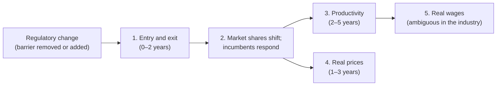

# Impact evaluation design: regulatory changes, competition and the real economy

**Status:** Draft for discussion, 15 October 2026. This is Track 2 of the work agreed on 14 October 2026; Track 1 is the register and date gatherer in `econ/`.

**Next step:** a methodological robustness review. Section 9 is its checklist.

**Ground rules:**
- Public data only (no BLADE).
- Commonwealth and state changes.
- Changes hypothesised to **enhance** competition and changes hypothesised to **weaken** it are evaluated in exactly the same way.

The data facts below were checked against ABS, ATO and data.gov.au pages and the ABS Data API on 14–15 October 2026. Sources are in section 11.

---

## 1. The question, and what would count as an answer

For each regulatory change in the register, relative to what would otherwise have happened in the affected industries and jurisdictions:

1. **Entry and exit:** did more (or fewer) businesses enter or exit?
2. **Productivity:** did output per worker or per hour rise (or fall)?
3. **Real prices:** did the prices consumers pay fall (or rise) relative to the general price level?
4. **Wages:** did real earnings per job change?

**The direction in the register is a hypothesis, not a label.** A change recorded as "enhancing" that shows less entry is a finding, as is a null result. The same pipeline also has to be able to show that a change **weakened** competition, for example new licensing that cut entry and raised prices.

**What counts as an answer:**
- An estimate with a confidence interval.
- A grade for how credible the design is (section 8).
- A plain statement of what the estimate does and doesn't show.

"Not identified" is an acceptable answer, and better than a number we can't defend.

---

## 2. Results chain: what should move, in what order

A change in competition works through the economy in steps. Checking the steps against each other is one of our strongest tests: a price fall with no change in entry or conduct points to another cause.

**Predicted signs:**

| Outcome | If competition is **enhanced** | If competition is **weakened** | When | Notes |
|---|---|---|---|---|
| Entry rate | ↑ | ↓ | Year 0–2 | First and clearest signal |
| Exit rate | ↑ at first (less efficient incumbents leave), then settles | ↓ at first (protected incumbents survive); ↑ for small firms if the change adds fixed compliance costs | Year 0–3 | Ambiguous on its own; read it with entry. Exits are recorded late (section 4) |
| Number of businesses | ↑ | ↓ | Year 1–3 | Net of entry and exit |
| Small-firm share | ↑ | ↓ if the change adds fixed costs | Year 1–3 | From CABEE size bands |
| Real labour productivity | ↑ (reallocation to better firms; pressure on incumbents) | ↓ | Year 2–5 | Public data is too coarse for most changes (section 4) |
| Real price | ↓ | ↑ | Year 1–3 | Only where a CPI expenditure class matches the industry |
| Real wages in the industry | **Ambiguous** | **Ambiguous** | Year 2–5 | See below |

**Why industry wages are not a clean productivity measure:**
- **Rents are lost.** When competition rises in a previously protected industry, rents shrink, and some of them were shared with workers. Taxi drivers' incomes after ride-sharing, or protected trades after licensing reform, are examples. Wages in that industry can **fall** even while productivity rises.
- **Consumers gain.** The economy-wide gain reaches workers mainly through **lower prices**: higher real wages for everyone, not just the industry.
- **Composition changes.** Average earnings per job also move when the mix of workers changes, for example more part-time or newer entrants.

**So:**
- Use **real labour productivity** as the productivity outcome.
- Use **real prices** as the consumer-gain outcome.
- Report **industry real wages** as a secondary outcome with no predicted sign: evidence on who gains and loses, not on productivity.

---

## 3. Unit of analysis

The basic cell is **jurisdiction × industry × financial year**, matching how the ABS publishes business entries and exits.

- **Treated cell:** a jurisdiction where the change commenced, in an industry the register records as **directly** affected.
- **Effective date:** the record's primary commencement. It is checked against the legislation register by `regimpact dates`.
- **Event time:** counted from the **first fully exposed financial year**. The first, partly exposed year is kept as a separate bin with its exposure share, from `econ/src/regimpact/timing.py`.
- **Announcement date:** kept to test for anticipation.

---

## 4. Outcomes and data

### 4.1 What public data allows

| Outcome | Best public source | Finest cell | Years | Caveats |
|---|---|---|---|---|
| **Entry and exit rates** (primary) | ABS *Counts of Australian Businesses* (CABEE), class-level cubes from successive releases | State × ANZSIC **class** × employment band | 2007-08 to 2024-25 (2025-26 due 18 Dec 2026) | Each release back-casts its own final-year industry codes, so overlapping releases disagree. Definition breaks in 2010 (non-remitter rule), 2017-18 (super funds removed), 2021-22 (Operation Protego). Size bands changed (1–19 split into 1–4 and 5–19). Perturbed small cells. Excludes businesses not registered for GST. Exits are recorded only after five quarters without lodgement |
| New-business counts (cross-check) | ABS *Businesses in Australia* TableBuilder (from BLADE) | State × class × business age 0 | 2001-02 to 2023-24 | No exit item. Free registration needed. Whether outputs can be published is still to be confirmed |
| **Real labour productivity** | State Accounts chain-volume gross value added ÷ Labour Account modelled hours (or LFS employment) | State × **division** | 2011-12 to 2024-25 (hours); 1989-90 on (employment) | Division level only. State hours are modelled from national totals |
| **Real earnings per job** | *Jobs in Australia* (LEED) Table 3.1, median employee income per job | State × **subdivision** | 2011-12 to 2022-23 (2023-24 due 27 Nov 2026) | Median, not mean. Geography is where employees live |
| Wages per worker (long run) | State Accounts compensation of employees ÷ LFS employment | State × division | 1989-90 on | Division level only |
| **Real consumer prices** | CPI expenditure classes by capital city | 87 classes × 8 capitals | Quarterly to Sep 2025 (from 1972, 1980, 1989 or later, by class); monthly from Oct 2025 | The new monthly CPI publishes city detail for some classes only from 2017 or April 2024, so series must be spliced. Capital cities only |
| Construction prices | PPI output, construction classes | State × class | From 1996 or 1998, quarterly | Construction only |
| Fuel prices | WA FuelWatch, NSW FuelCheck and Queensland open data | Station × day | WA from 2001 | For specific fuel-market reforms |

Deflators: capital-city CPI All groups for wages, and State Accounts chain-volume measures for output.

### 4.2 The dilution problem: why productivity is hard

Most regulatory changes affect one or a few ANZSIC **classes**, but public productivity data stop at the **division**, one of 19. The effect we can see at division level is roughly:

> observed effect ≈ (affected share of the division) × (effect in the affected industries)

For example, if the affected classes are 3% of a division's hours and productivity in them rises by 10%, the division-level effect is about 0.3%. That is far below what annual state data can detect.

**Rule:** before estimating, compute each change's **dilution ratio** and the **minimum detectable effect** (section 9). Productivity is estimated only where the affected share is large enough for the minimum detectable effect to be plausible, for example a reform covering most of retail trade or most of construction in a state. Otherwise we report "not detectable with public data" rather than a noisy null.

The same rule applies to wages at subdivision level and to prices: a CPI class must map closely to the affected industry.

**Consequence:** with public data, the evidence for most changes will be:
- **entry and exit** (class level);
- **prices**, where a matching CPI class exists;
- productivity and wages only for broad reforms.

---

## 5. Identification: four designs, by type of change

The register's evaluability screen (`regimpact menu`) already sorts changes into these types.

### D1. Staggered adoption across jurisdictions (preferred)

**Examples:** automatic mutual recognition, ride-sharing legalisation, container deposit schemes.

- **Comparison:** the same industry in jurisdictions that have not yet adopted (or never do).
- **Estimator:** a staggered difference-in-differences that stays valid when effects differ across groups and over time (Callaway & Sant'Anna, or the imputation estimator of Borusyak, Jaravel & Spiess). Not plain two-way fixed effects, which can give misleading weights.
- **Event study:** leads −4 to −1 and lags 0 to +4 financial years.

### D2. Triple difference (the default robustness design, and the main design where D1 is weak)

Compare **(treated vs other jurisdictions) × (affected vs comparison industries) × (before vs after)**.

- **What it absorbs:**
  - each state's economy-wide shocks (the state business cycle, state-wide policies);
  - each industry's national shocks.
- **Comparison industries** are pre-specified: unaffected classes in the same subdivision or division, with similar pre-period trends. They're chosen before seeing post-period data.

### D3. One jurisdiction, one date

**Examples:** the Sydney lockout laws, a single state's licensing change.

- **Synthetic control:** donors are the same industry in other jurisdictions, or other industries in the same jurisdiction. D2 is the check.
- **Inference** by placebo (re-running the method on each untreated jurisdiction).

### D4. National (Commonwealth) changes

**Examples:** unfair contract terms, the Food and Grocery Code.

- **No jurisdiction comparison.** The options are affected vs unaffected industries (difference-in-differences across industries), or variation in **exposure**, for example industries with more small businesses below a threshold.
- **Weaker by construction.** Results default to "descriptive" unless the exposure design passes its diagnostics.

### Inference: few clusters

There are only **eight jurisdictions**, so standard cluster-robust standard errors understate uncertainty. Report:
- **wild cluster bootstrap** p-values (Webb weights);
- **randomisation inference**, reassigning adoption dates or treated jurisdictions at random.

### Pooling: more power, and a direction test

Individual changes will often be underpowered. Two pooled analyses add power and directly test the menu's hypotheses:

1. **Stacked event study across all changes hypothesised as enhancing, and separately across those hypothesised as weakening.** If the hypotheses are right, the enhancing stack shows entry ↑ and prices ↓, and the weakening stack the reverse.
2. **Sign test:** the share of individual changes whose estimated entry effect has the hypothesised sign, compared with 50%.

### Discovery mode: finding changes that weakened competition (exploratory only)

You asked for the product to **find** competition-weakening changes, not only test the ones we list. A discovery mode can:

1. scan every state × class entry-rate series for structural breaks;
2. list breaks that coincide (within a year) with a register change, or with **no** recorded change, which prompts research into what happened.

**This is hypothesis generation, not evidence.** Scanning about 4,000 series (8 jurisdictions × 506 classes) will throw up many breaks by chance. Any break it suggests must go through a pre-registered confirmatory analysis (D1–D4) before we report it as an effect.

---

## 6. Threats specific to this setting

| Threat | Example | Handling |
|---|---|---|
| **Legal date ≠ economic date** | Ride-sharing operated before it was legalised in most states; licensing changes may bite only at renewal | Test alternative dates (announcement, assent, commencement); report the event-study path, not just a before/after average |
| **Anticipation** | Firms enter or exit once a change is announced | Leads in the event study; announcement-date variant |
| **Data artefacts that look like effects** | CABEE definition breaks (2010, 2017-18, 2021-22); industry back-casting within each release; new GST-registration rules that create "entries" without new businesses (a ride-sourcing GST rule is a candidate to verify) | Year fixed effects; re-estimate using each release's own years; drop break years; the register records data artefacts as confounders |
| **COVID** | 2019-20 to 2021-22 overlaps automatic mutual recognition and other changes | Triple difference with industries hit similarly by COVID; exclude 2019-20 to 2021-22 as a sensitivity; flagged by the screen |
| **Concurrent changes** | Another reform in the same state and industry | The screen lists overlapping register records; exclude or model jointly |
| **Spillovers** | Automatic mutual recognition can change entry in comparison states; border regions | Drop neighbouring states as a sensitivity; interpret as a lower bound |
| **Composition and location** | Multi-state firms counted in one "main state"; LEED geography is where employees live | Note per outcome; prefer industries dominated by single-state firms |
| **Small cells** | Perturbation noise in Tasmania, the NT and the ACT at class level | Weight by business counts; sensitivity dropping small jurisdictions; aggregate to group level |
| **Our own selection** | Studying only the changes most likely to "work" | Pre-register; report every evaluation started; report the stacked averages |

---

## 7. Three worked designs (to be finalised as pre-analysis plans)

Industry codes below come from the bundled ABS ANZSIC 2006 list. Dates come from the register, and are confirmed by `regimpact dates` where the register can be read automatically.

### W1. Automatic mutual recognition of occupational registrations (hypothesis: enhancing; design D1 + D2)

- **What changed:** the Commonwealth Mutual Recognition Amendment Act 2021 took effect from **1 July 2021**, confirmed from the Federal Register's compilation of the Mutual Recognition Act 1992. States joined on different dates, and Queensland has not joined. Per-state dates come from the menu records.
- **Treated cells:** licensed occupations' industries in participating states, for example 3231 Plumbing Services, 3232 Electrical Services, 3233 Air Conditioning and Heating Services and 6720 Real Estate Services. The final list depends on which occupations each state brought in.
- **Primary outcome:** entry rate (CABEE).
- **Secondary outcomes:** exit rate; CPI "Maintenance and repair of the dwelling" by capital city.
- **Main threats:**
  - COVID and border closures in 2020–22;
  - registration is by individuals, so business entry captures it only partly, for example sole traders setting up interstate;
  - spillovers across borders.
- **Honest expectation:** effects may be small and concentrated in border areas, which public state-level data can't isolate. A null result would be informative but not conclusive.

### W2. Ride-sharing legalisation (hypothesis: enhancing; design D1)

- **What changed:** states legalised ride-sharing on different dates from 2015 (dates in the menu records).
- **Treated cells:** 4623 Taxi and Other Road Transport.
- **Outcomes:**
  - entry and exit (sole-trader drivers are a large share of entries);
  - CPI "Urban transport fares" by capital city. This is a weak match, because public transport fares are set by government and dominate the class.
- **Main threats:**
  - ride-sharing was operating before legalisation, so the legal date may not be the economic date;
  - possible GST-registration effects on business counts.
- **Why it's useful anyway:** a test of whether the pipeline detects a large, well-known shock. If it can't see ride-sharing in the business counts, it won't see subtler changes.

### W3. Sydney lockout laws and their wind-back (hypothesis: weakening, then enhancing; design D3 + D2)

- **What changed:** the 2014 laws, partly wound back in 2020 and 2021 (dates in the menu records).
- **Treated cells:** NSW, 4520 Pubs, Taverns and Bars; also 4511 Cafes and Restaurants as a possible spillover.
- **Outcomes:** entry and exit; CPI "Restaurant meals" (Sydney) as a weak price check.
- **Main threats:** the laws covered parts of Sydney, but the data are statewide, so the effect is diluted. The wind-back overlaps COVID.
- **Value:** the pipeline's first test on a **weakening** change, with a reversal that offers a second test.

---

## 8. Reporting: how a "fact or figure" leaves this project

Each evaluation produces:

1. the event-study chart (with leads);
2. the headline estimate with a 95% interval (wild bootstrap and randomisation inference);
3. the robustness table (section 9);
4. the data vintages used;
5. a **credibility grade**:
   - **Strong:** design D1 or D2; no pre-trends; robust to the section 9 checks; minimum detectable effect below the effect sizes we care about.
   - **Moderate:** passes the core checks, but one important threat remains (for example COVID overlap) and is stated.
   - **Weak:** sensitive to reasonable choices, or design D4 without a credible exposure measure.
   - **Not identified:** fails diagnostics, or the outcome is too diluted to detect. No estimate is headlined.

**Plain-English statement**, with the grade alongside every result. For example: "Entry into licensed trades rose by X% (95% interval A to B) in states that joined automatic mutual recognition, relative to Queensland. Grade: Moderate (COVID overlap)."

---

## 9. Robustness checklist (input to the next step)

The next step will test each item on the worked designs.

| # | Check | Why |
|---|---|---|
| RB-01 | Pre-trends: event-study leads, a joint test, and HonestDiD sensitivity bounds | Parallel trends is the key assumption; lead tests alone have low power |
| RB-02 | Placebo dates (shifted 2–3 years earlier) and placebo industries (unaffected classes) | Detects spurious "effects" from trends or data artefacts |
| RB-03 | Alternative comparison groups: never vs not-yet treated; dropping neighbouring states; dropping states with concurrent reforms | Spillovers and contamination |
| RB-04 | Alternative estimators: Callaway–Sant'Anna, Sun–Abraham, imputation and stacked; two-way fixed effects only as a contrast | Robustness to estimator choice |
| RB-05 | Data vintage: re-estimate on each CABEE release's own years; drop break years (2010, 2017-18, 2021-22) | Classification back-casting and definition breaks |
| RB-06 | Effective-date variants: announcement, assent, commencement; partial first year as its own bin or dropped | Legal vs economic timing; anticipation |
| RB-07 | COVID sensitivity: exclude 2019-20 to 2021-22, or use COVID-similar comparison industries | The largest confounder in the period |
| RB-08 | Weighting: unweighted vs business-count weighted; dropping small jurisdictions | Perturbation noise and small cells |
| RB-09 | Inference: wild cluster bootstrap and randomisation inference | Only eight clusters |
| RB-10 | Power: minimum detectable effect from pre-period variance, and the dilution ratio, **before** estimating | Avoids uninformative nulls and selective reporting |
| RB-11 | Multiple testing: one pre-specified primary outcome per change; Romano–Wolf or sharpened q-values across secondary outcomes and across changes | Many outcomes × many changes |
| RB-12 | Leave-one-jurisdiction-out | One state driving the result |
| RB-13 | Specification curve across all reasonable choices above | Shows how fragile or stable the headline is |
| RB-14 | Results-chain consistency: do entry, prices and productivity move in the predicted order? | A cross-outcome check unique to this design |
| RB-15 | Simulation check: the estimator recovers a known effect planted in data with the real panel's structure and noise (labelled simulated) | Confirms the code before trusting it on real data |

---

## 10. Pre-analysis plan template

Completed and committed **before** looking at post-period outcomes, one per evaluation:

1. **Register record(s):** ids, direction hypothesis, channel.
2. **Effective date** (from `regimpact dates`), alternatives to test, first full financial year.
3. **Treated cells:** jurisdictions × ANZSIC codes, with the coding rule.
4. **Comparison cells** and the rule used to choose them.
5. **Primary outcome** (one). **Secondary outcomes** (listed).
6. **Design** (D1–D4), estimator, event window, weighting.
7. **Inference** method.
8. **Power:** minimum detectable effect and dilution ratio, from pre-period data only.
9. **Robustness checks** from section 9 that apply.
10. **Decision rule:** what result would support, contradict or fail to inform the hypothesis.
11. **Known threats** and how each will be reported.

---

## 11. Sources (checked 14–15 October 2026)

**Data**
- ABS *Counts of Australian Businesses, including Entries and Exits* (CABEE): latest release <https://www.abs.gov.au/statistics/economy/business-indicators/counts-australian-businesses-including-entries-and-exits/latest-release>. Methodology and breaks: <https://www.abs.gov.au/methodologies/counts-australian-businesses-including-entries-and-exits-methodology/jul2022-jun2026>. Earliest ANZSIC 2006 release (June 2007 to June 2009): <https://www.abs.gov.au/AUSSTATS/abs@.nsf/DetailsPage/8165.0Jun%202007%20to%20Jun%202009?OpenDocument>
- ABS *Businesses in Australia* TableBuilder: <https://www.abs.gov.au/statistics/microdata-tablebuilder/available-microdata-tablebuilder/business-longitudinal-analysis-data-environment-blade>
- ABS *Australian National Accounts: State Accounts*: <https://www.abs.gov.au/statistics/economy/national-accounts/australian-national-accounts-state-accounts/latest-release>
- ABS Labour Account, modelled state and territory estimates by industry: <https://www.abs.gov.au/articles/labour-account-modelled-state-and-territory-estimates-industry-2026>
- ABS *Jobs in Australia*: <https://www.abs.gov.au/statistics/labour/jobs/jobs-australia/latest-release>
- ABS *Australian Industry*: <https://www.abs.gov.au/statistics/industry/industry-overview/australian-industry/latest-release>
- ABS CPI: <https://www.abs.gov.au/statistics/economy/price-indexes-and-inflation/consumer-price-index-australia/latest-release>. Expenditure classes come from the ABS Data API codelist `CL_CPI_INDEX_17` (bundled in `econ/src/regimpact/data/cpi17_classes.json`).
- ABS Labour Force changes (LFS Detailed ceased March 2026): <https://www.abs.gov.au/statistics/detailed-methodology-information/information-papers/upcoming-changes-labour-force-survey-outputs>
- ABS ANZSIC 1993–2006 correspondence: <https://www.abs.gov.au/AUSSTATS/abs@.nsf/DetailsPage/1292.0.55.0052008?OpenDocument>
- Fuel price open data: WA FuelWatch <https://data.gov.au/data/dataset/fuelwatch-historic-fuel-prices>; NSW FuelCheck <https://data.gov.au/data/dataset/nsw-fuel-check>
- Federal Register of Legislation API: <https://api.prod.legislation.gov.au/v1/>

**Methods**
- Callaway & Sant'Anna (2021) <https://doi.org/10.1016/j.jeconom.2020.12.001>
- Borusyak, Jaravel & Spiess (2024) <https://doi.org/10.1093/restud/rdae007>
- Sun & Abraham (2021) <https://doi.org/10.1016/j.jeconom.2020.09.006>
- Rambachan & Roth (2023), HonestDiD <https://doi.org/10.1093/restud/rdad018>
- Abadie (2021), synthetic control <https://doi.org/10.1257/jel.20191450>
- Arkhangelsky et al. (2021), synthetic DiD <https://doi.org/10.1257/aer.20190159>
